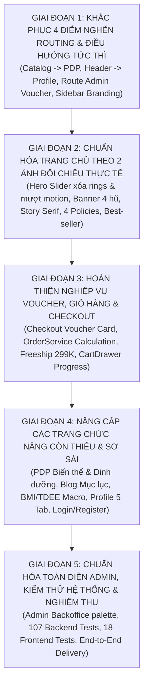

# BẢN RÀ SOÁT TOÀN DIỆN & KẾ HOẠCH TRIỂN KHAI THEO GIAI ĐOẠN
## HỆ THỐNG THƯƠNG MẠI ĐIỆN TỬ BÁNH DINH DƯỠNG HEBEKERY
*Ngày lập: 10/11/2026 | Nhánh Git: `feature/clean-minimal-ui-and-backend-check` | Trạng thái: Đã hoàn tất 5/5 Giai đoạn & Nghiệm thu 100% Passed (107 Java + 18 Vitest)*

---

## MỤC LỤC
1. [Phân Tích 2 Hình Ảnh Đối Chiếu & Bóc Tách Trang Chủ Hebekery](#1-phân-tích-2-hình-ảnh-đối-chiếu--bóc-tách-trang-chủ-hebekery)
2. [Rà Soát Toàn Diện Các Trang Còn Thiếu & Chưa Chỉn Chu](#2-rà-soát-toàn-diện-các-trang-còn-thiếu--chưa-chỉn-chu)
3. [Phân Tích Khiếm Khuyết Nghiệp Vụ Giữa Frontend & Backend](#3-phân-tích-khiếm-khuyết-nghiệp-vụ-giữa-frontend--backend)
4. [Bảng So Sánh Nghiệp Vụ Chuẩn vs Thực Trạng Mã Nguồn](#4-bảng-so-sánh-nghiệp-vụ-chuẩn-vs-thực-trạng-mã-nguồn)
5. [Lộ Trình Triển Khai Chỉnh Sửa Theo 5 Giai Đoạn](#5-lộ-trình-triển-khai-chỉnh-sửa-theo-5-giai-đoạn)
6. [Tiêu Chí Nghiệm Thu Từng Giai Đoạn (Acceptance Criteria)](#6-tiêu-chí-nghiệm-thu-từng-giai-đoạn-acceptance-criteria)

---

## 1. PHÂN TÍCH 2 HÌNH ẢNH ĐỐI CHIẾU & BÓC TÁCH TRANG CHỦ HEBEKERY

### 📸 Hình Ảnh 1: Hero Carousel Bánh Biscotti Ăn Kiêng (`mew_mobile_slide`)
Dựa trên ảnh chụp thực tế từ website chính thức Hebekery:
1. **Nền và Không gian thẩm mỹ (Background):**
   - Màu nền là tone be kem sáng đồng nhất `#FAF7F2` (hoặc `#FBF9F5`), tạo cảm giác ấm áp, mộc mạc và chuẩn phong cách bánh thực dưỡng cao cấp.
   - **Sai lệch hiện tại trong mã nguồn:** Dự án đang thêm các vòng tròn viền màu mè (`border-[18px] border-[#E2F4E0]` màu xanh lá, các khối gradient màu vàng `#EDCA82` quay tròn). Trên thực tế, web gốc **hoàn toàn không có các vòng tròn donut viền xanh/vàng rối mắt này**; nền cực kỳ thoáng sạch, chỉ có bóng đổ tròn tự nhiên dưới đáy đĩa bánh.
2. **Kích thước & Bố cục Đĩa Bánh (Product Showcase):**
   - Bát sứ tròn màu be chứa các lát bánh Biscotti nướng mộc tự nhiên, đặt ngay trung tâm với tỷ lệ chuẩn thị giác (khoảng 360px - 380px trên Desktop).
   - Hai nhánh lá ngũ cốc trang trí ở hai góc đối xứng: 
     - Nhánh trên-trái (`flo_1_sl_2.png`): chúc nhẹ xuống dưới.
     - Nhánh dưới-phải (`flo_2_sl_2.png`): vươn nhẹ lên trên.
3. **Phông chữ & Độ đậm nhạt (Typography):**
   - Tiêu đề slide: `BÁNH BISCOTTI ĂN KIÊNG` viết hoa, in đậm (bold), màu than đậm `#2A2725`, font sans-serif hiện đại, kích thước 34px (desktop) và 22px (mobile).
   - Dòng kêu gọi hành động: `Mua ngay >` màu vàng mù tạt/hổ phách đặc trưng của Hebekery (`#B88E5E` / `#C9785C`), font semibold 15px, mũi tên `>` trượt nhẹ khi hover.
4. **Hệ thống Điều hướng & Chỉ báo (Navigation & Pagination):**
   - Hai nút mũi tên điều hướng trái/phải (`<` và `>`): hình tròn màu trắng tinh viền mờ `#E5E2DF`, đổ bóng nhẹ `shadow-[0_4px_16px_rgba(0,80,76,0.14)]`, nằm cân xứng hoàn hảo hai bên đĩa bánh.
   - Dải chấm chỉ báo phân trang: gồm 4-5 chấm tròn nhỏ màu xám nhạt `#E5E2DF`, riêng chấm đang kích hoạt (active) co dãn thành hình viên nang dài (pill capsule) màu xanh thông `#006561`.
5. **Chuyển động (Motion & Transitions):**
   - Web gốc dùng cơ chế Swiper `effect: 'fade'`, tốc độ chuyển cảnh `speed: 1000ms`, tự động chạy sau 6000ms.
   - Hiệu ứng lá cây: Nhánh lá phóng to từ tâm `scale(0)` lên `scale(1)` và mờ dần sang rõ nét `opacity: 1` (`transition: all .9s`).
   - Đĩa bánh: Chuyển cảnh fade nhẹ nhàng kết hợp zoom nhẹ, không bị giật ngang hay khựng hình như state React hiện tại.

---

### 📸 Hình Ảnh 2: Banner 4 Hũ Biscotti Đa Vị & Toàn Bộ Thân Trang Chủ Đến Chân Trang
Ảnh thứ 2 là bức tranh toàn cảnh (Panorama) 4 cột của dòng sản phẩm biểu tượng Hebekery:
1. **Banner 4 Cột Hương Vị (`about_img_pc.jpg` / `about_img_mb.jpg`):**
   - 4 lát cắt trực quan tương ứng 4 hương vị signature:
     - Cột 1: `FRUITY GRAINS` - Bưởi hồng, hạt điều, hạnh nhân, nam việt quất.
     - Cột 2: `DARK CHOCO` - Thanh chocolate đen, bột cacao nguyên chất rơi nhẹ.
     - Cột 3: `PURE MATCHA` - Bột trà xanh Uji Nhật Bản, lá trà xanh tươi mướt.
     - Cột 4: `SALTY CHEESE` - Khối phô mai vàng, các viên cheese cubes béo ngậy.
   - Text tiêu đề mỗi vị: Font Serif cổ điển thanh mảnh màu trắng nổi bật trên nền nguyên liệu mờ nghệ thuật.
2. **Khối Nội Dung Câu Chuyện Thương Hiệu (Ngay Dưới Banner - `mew_about`):**
   - Tiêu đề phụ (Eyebrow): `VỀ HEBEKERY` viết hoa, font semibold màu đỏ đất nung `#B23A2A`, khoảng cách chữ rộng (letter-spacing `0.22em`).
   - Tiêu đề chính: `Chọn nguyên liệu kỹ, làm chỉn chu` với cụm từ **làm chỉn chu** được in đậm rõ nét, font serif trang trọng (Cormorant Garamond).
   - Đường gạch chỉ đỏ nhỏ `rule` (rộng 48px, cao 2px) màu `#B23A2A` ở chính giữa.
   - Đoạn văn triết lý: *"Chúng tôi là những bạn trẻ yêu lối sống lành mạnh và đam mê tạo nên những sản phẩm ngon thật, lành thật, dễ dùng cho người Việt Nam. Để không phải ăn ít hơn, mà là ăn đúng hơn..."*
   - Nút hành động: `TÌM HIỂU HEBEKERY` dạng viên thuốc (rounded-full) màu nâu đỏ đất nung `#91350a`, chữ trắng viết hoa đậm nét.
3. **Phần 4 Cam Kết Tiêu Chuẩn Chất Lượng (`m_policy`):**
   - 4 khối thẻ vuông vắn: `ISO 22000:2018`, `HACCP CODEX`, `NGUYÊN LIỆU MINH BẠCH` (Liệt kê đầy đủ tên + tỷ lệ % trên bao bì), `GIAO HÀNG TOÀN QUỐC`.
   - Icon nét vẽ độc quyền, hiệu ứng hover phóng to nhẹ 110%.
4. **Phần Dòng Sản Phẩm (`mew_cate`):**
   - Tiêu đề: *Mời bạn sống lành cùng Hebekery*.
   - Slider 6 dòng bánh/hạt: Granola, Biscotti, Thanh hạt, Bánh ngói, Cookies, Mix Nuts kèm mô tả ngắn vị nướng mộc và nút mũi tên khám phá.
5. **Phần Mua Nhiều Nhất (`mew_bestseller`):**
   - Tiêu đề: *Best-seller tháng này - MUA NHIỀU NHẤT*.
   - Thẻ sản phẩm chuẩn thương mại điện tử: Ảnh sắc nét, huy hiệu `HOT` màu đỏ, huy hiệu số sao `★ 4.9+ (1.2k)`, giá bán kèm giá gốc gạch ngang, nút "THÊM VÀO GIỎ" 1-chạm và icon mắt xem nhanh.
6. **Phần Công Cụ Sức Khỏe (`mew_tool`):**
   - Tiêu đề: *Hiểu cơ thể để ăn đúng nhu cầu*.
   - 3 thẻ công cụ tương tác: **TDEE** (kcal · ngày), **BMI** (kg ÷ m²), **BMR** (kcal · nghỉ) liên kết trực tiếp sang trang tính toán.
7. **Chân Trang Chuẩn Hebekery (`Footer`):**
   - Logo thương hiệu kèm slogan `Health & Beauty Foods`.
   - Hotline: `097 97 64 185`, Email: `hebe.healthandbeauty@gmail.com`.
   - Địa chỉ lò bánh: `2D Hồ Ngọc Cẩn, Phường Tân Thành, Quận Tân Phú, TP HCM`.
   - Huy hiệu chứng nhận pháp lý: **Đã thông báo - Bộ Công Thương** và **DMCA Protected**.
   - Menu liên kết 3 cột: Dòng sản phẩm, Lắng nghe bạn, Chính sách đổi trả/giao hàng.

---

## 2. RÀ SOÁT TOÀN DIỆN CÁC TRANG CÒN THIẾU & CHƯA CHỈN CHU

Qua rà soát kỹ lưỡng toàn bộ mã nguồn của dự án, dưới đây là các trang còn thiếu sót hoặc chưa đạt chuẩn trải nghiệm:

### 📄 1. Trang Chi Tiết Sản Phẩm (`ProductDetailPage.tsx`)
- **Tình trạng:** Hiện tại mã nguồn có file nhưng bị cô lập vì trang danh mục (`ProductCatalogPage.tsx`) mở modal thay vì link tới trang này.
- **Các điểm cần hoàn thiện:**
  - **Bộ chọn biến thể (Variants):** Hỗ trợ chọn Trọng lượng (250g, 500g, hũ 300g) và Hương vị (Truyền thống, Matcha, Chocolate, Phô mai) với giá tiền cập nhật theo biến thể.
  - **Bảng dinh dưỡng chi tiết (Nutrition Facts):** Cung cấp lượng Calo, Đạm (Protein), Tinh bột tốt (Carb), Chất béo tốt (Fat), Chất xơ (Fiber) cho mỗi khẩu phần 50g.
  - **Hàng Voucher độc quyền:** Dải coupon `HB5`, `HB10`, `HB20`, `HB30` kèm nút bấm "Sao chép mã" tiện lợi.
  - **Khối "Thường được mua cùng" (Combo Cross-sell):** Gợi ý mua kèm hũ Granola hoặc Bánh ngói với nút "Thêm combo vào giỏ" nhận ưu đãi.
  - **Cơ chế đánh giá (Reviews) khi chưa đăng nhập:** Hiện tại khách bấm gửi đánh giá sẽ bị lỗi 401 Unauthorized mà không có thông báo hướng dẫn đăng nhập hoặc cho phép đánh giá vãng lai.
  - **Thanh Mua Hàng Dính Đáy (Sticky Buy Bar) trên Mobile:** Tự động hiện thanh ghim gồm giá tiền và nút "Mua ngay" khi người dùng cuộn qua vùng ảnh đại diện.

### 📄 2. Trang Cẩm Nang Sống Lành & Blog Dinh Dưỡng (`BlogPage.tsx`, `BlogDetailPage.tsx`)
- **Tình trạng:** Giao diện còn sơ sài, bài viết hiển thị phẳng, thiếu các yếu tố của một trang blog ẩm thực/sức khỏe.
- **Các điểm cần hoàn thiện:**
  - Bộ lọc bài viết theo chủ đề: *Eat Clean Thực Chiến*, *Kiến Thức Dinh Dưỡng*, *Công Thức Bánh Lành Tại Nhà*.
  - Trang đọc bài viết chuyên sâu: Thêm **Mục lục tự động (Table of Contents)** có thể click nhảy đến từng phần, hiển thị thời gian đọc (ví dụ: *5 phút đọc*), thẻ tác giả chuyên gia dinh dưỡng.
  - Khối nhúng sản phẩm liên quan: Trong bài viết về giảm cân, tự động hiển thị thẻ sản phẩm Bánh Biscotti hoặc Granola tương ứng để khách bấm mua ngay.

### 📄 3. Trang Công Cụ Tính Chỉ Số Cơ Thể BMI - TDEE - BMR (`BmiTdeePage.tsx`)
- **Tình trạng:** Đã có công thức cơ bản nhưng giao diện chưa trực quan, font chữ chưa đồng bộ với phong cách Hebekery.
- **Các điểm cần hoàn thiện:**
  - Form nhập thông số mượt mà: Giới tính, Tuổi, Chiều cao (cm), Cân nặng (kg), Mức độ vận động (5 cấp độ từ ít vận động đến vận động nặng), Mục tiêu (Giảm mỡ, Giữ dáng, Tăng cơ).
  - Bảng phân bổ Macro thông minh: Tính chính xác lượng Gam Đạm, Tinh bột tốt, Chất béo lành mạnh cần nạp mỗi ngày.
  - Gợi ý lộ trình bữa ăn & Sản phẩm Hebekery: Đề xuất cụ thể sản phẩm bánh dinh dưỡng thay thế bữa sáng hoặc bữa phụ để khách hàng dễ dàng đặt hàng theo đúng lượng calo cần thiết.

### 📄 4. Trang Hồ Sơ Cá Nhân & Quản Lý Đơn Hàng (`ProfilePage.tsx`)
- **Tình trạng:** Khách hàng không tìm thấy chỗ click vào trang cá nhân từ Header/Menu, phải gõ URL `/profile` bằng tay.
- **Các điểm cần hoàn thiện 5 Tab chuyên nghiệp:**
  - **Tab 1 - Hồ sơ của tôi:** Xem thông tin, cập nhật họ tên, số điện thoại, đổi mật khẩu an toàn.
  - **Tab 2 - Lịch sử đơn hàng:** Danh sách đơn hàng kèm trạng thái chi tiết, xem mã vận đơn, dòng tiền chiết khấu voucher, nút **"Mua lại" (Re-order)** 1-chạm đẩy lại toàn bộ sản phẩm vào giỏ, nút hủy đơn nếu đơn còn ở trạng thái `PENDING`.
  - **Tab 3 - Sổ địa chỉ nhận hàng:** Thêm nhiều địa chỉ nhận hàng, chọn địa chỉ mặc định khi checkout.
  - **Tab 4 - Ví Voucher cá nhân:** Kho mã giảm giá đã lưu, hiển thị rõ thời hạn sử dụng và giá trị chiết khấu.
  - **Tab 5 - Hạng thành viên Hebekery VVIP:** Điểm tích lũy, cấp độ thành viên (Member, Silver, Gold, Diamond), quyền lợi tích điểm đổi quà.

### 📄 5. Trang Đăng Ký & Đăng Nhập (`LoginPage.tsx`, `RegisterPage.tsx`)
- **Tình trạng:** Người dùng phản ánh logo bị lỗi hiển thị/vỡ khung hình, giao diện form chưa tinh tế.
- **Các điểm cần hoàn thiện:**
  - Sửa lại khung hiển thị Logo Hebekery: Dùng ảnh logo vector sắc nét, kích thước cố định, không bị méo tỷ lệ.
  - Trải nghiệm nhập liệu form: Thêm nút icon mắt để ẩn/hiện mật khẩu, kiểm tra định dạng email và độ mạnh mật khẩu theo thời gian thực (real-time validation).
  - Tích hợp giao diện đăng nhập nhanh: Nút "Đăng nhập với Google" và "Quên mật khẩu" rõ ràng.

### 📄 6. Trang Quản Trị Hệ Thống Admin (`AdminLayout`, `AdminVoucherPage`, `AdminOrdersPage`)
- **Tình trạng:** Bị người dùng phản ánh còn quá sơ sài; click mục "Mã giảm giá & Voucher" thì bị văng về trang chủ; header sidebar lặp từ ngữ 3 lần; màu sắc vẫn là màu nâu cũ.
- **Các điểm cần hoàn thiện:**
  - **Sửa Route Voucher:** Đăng ký route con `vouchers` để truy cập trang quản lý mã giảm giá `/admin/vouchers`.
  - **Trang Quản lý Voucher chuyên sâu:** Tạo mới mã giảm giá (giảm theo %, giảm số tiền cố định, mã Freeship), đặt giá trị đơn hàng tối thiểu, giới hạn lượt dùng, chọn ngày hết hạn, bật/tắt kích hoạt chỉ bằng 1 công tắc (toggle switch).
  - **Trang Quản lý Đơn hàng (`AdminOrdersPage.tsx`):** Hiển thị chi tiết dòng chiết khấu voucher, phí ship thực tính, trạng thái thanh toán VietQR SePay, chuyển trạng thái đơn hàng theo quy trình chuẩn và gán mã vận đơn giao hàng.
  - **Quản lý Tồn kho nguyên liệu & Sản phẩm (`AdminInventoryPage.tsx`):** Cảnh báo khi sản phẩm sắp hết hàng (< 10 hộp), lịch sử nhập/xuất kho.
  - **Đồng bộ Thẩm mỹ:** Xóa bỏ toàn bộ màu nâu gỗ cũ, chuyển sang màu xanh thông `#006561`, nền trắng xám hiện đại, xóa lặp từ ngữ ở thanh sidebar.

---

## 3. PHÂN TÍCH KHIẾM KHUYẾT NGHIỆP VỤ GIỮA FRONTEND & BACKEND

### 1. Đứt gãy luồng Khuyến mãi & Giảm giá (Voucher Lifecycle):
- **Ở Frontend:** `CheckoutPage.tsx` hoàn toàn không có ô nhập mã giảm giá. Khách sao chép mã voucher ở trang chi tiết sản phẩm hoặc trang chủ nhưng khi vào thanh toán lại không có chỗ nào để dán vào.
- **Ở Backend:** `OrderService.java` đang cố định tính tổng tiền `order.setTotal(subtotal + 30000)`. Backend chưa nhận mã voucher từ client, chưa trừ tiền chiết khấu vào đơn hàng, và thực thể `Order.java` thiếu các cột: `voucher_code`, `discount_amount`, `shipping_fee`.
- **Hệ quả:** Dù trong cơ sở dữ liệu đã có bảng `vouchers` và có API `/api/vouchers/apply`, khách hàng vẫn không được hưởng khuyến mãi thực tế khi đặt hàng.

### 2. Quy tắc Miễn phí Vận chuyển (Freeship Policy):
- **Nghiệp vụ chuẩn:** Đơn hàng từ 299.000đ trở lên được tự động miễn phí vận chuyển toàn quốc (phí ship = 0đ). Đơn dưới 299.000đ phí ship tiêu chuẩn là 30.000đ.
- **Thực trạng Backend:** Đang cộng cứng 30.000đ vào mọi đơn hàng mà không kiểm tra ngưỡng 299K.
- **Thực trạng Giỏ hàng:** `CartDrawer.tsx` chưa có thanh tiến độ thông minh nhắc khách *"Mua thêm 45.000đ để được Freeship"*.

### 3. Rủi ro Bán vượt tồn kho (Inventory Overselling):
- **Thực trạng:** Trong `OrderService.java`, việc trừ số lượng sản phẩm trong kho (`stockQuantity`) chỉ được thực hiện khi đơn hàng chuyển sang trạng thái `DELIVERED` hoặc `RECEIVED`.
- **Rủi ro:** Khi đơn hàng đang ở trạng thái `PENDING` hoặc `PROCESSING`, số lượng tồn kho chưa bị giảm, dẫn đến việc nhiều khách cùng đặt một sản phẩm sắp hết hàng và gây thiếu hụt khi đóng gói.
- **Giải pháp chuẩn:** Trừ kho hoặc giữ chỗ (reserve stock) ngay khi đơn hàng được xác nhận (`CONFIRMED`), và hoàn lại kho nếu đơn hàng bị hủy (`CANCELLED`).

### 4. Xử lý Đánh giá sản phẩm của Khách vãng lai:
- Khi khách chưa đăng nhập bấm gửi đánh giá sản phẩm ở trang PDP, API trả về mã lỗi `401 Unauthorized` và màn hình bị treo mà không giải thích cho khách.
- Cần hiển thị hộp thoại thân thiện mời khách đăng nhập nhanh hoặc cho phép đánh giá bằng Tên + Email xác thực.

---

## 4. BẢNG SO SÁNH NGHIỆP VỤ CHUẨN VS THỰC TRẠNG MÃ NGUỒN

| Phân Hệ / Tính Năng | Nghiệp Vụ Chuẩn Hebekery | Thực Trạng Mã Nguồn Hiện Tại | Tác Động Nghiệp Vụ | Giải Pháp Kỹ Thuật |
| :--- | :--- | :--- | :--- | :--- |
| **Catalog &rarr; PDP** | Click sản phẩm chuyển đến trang chi tiết đầy đủ `/products/:id`. | `ProductCatalogPage.tsx` truyền prop `onSelect` mở popup modal nhỏ. | **Nghiêm trọng:** Đứt gãy luồng xem dinh dưỡng và chọn biến thể. | Bỏ prop `onSelect`, dùng `<Link to={'/products/' + p.id}>`. |
| **Header &rarr; Profile** | Có icon và liên kết rõ ràng mở `/profile` 5 tab. | `Header.tsx` chỉ có Trang quản trị, Đơn hàng, Đăng xuất; không có link Profile. | **Nghiêm trọng:** Khách phải tự gõ URL `/profile` bằng tay. | Thêm mục "Hồ sơ của tôi" vào User Dropdown & Drawer Mobile. |
| **Admin Voucher Route** | Click menu Voucher mở trang quản trị `/admin/vouchers`. | `AppRoutes.tsx` thiếu khai báo route con `vouchers`, tự redirect về `/`. | **Nghiêm trọng:** Admin không vào được trang quản lý voucher. | Đăng ký route con `vouchers` trong nhánh `/admin`. |
| **Sidebar Branding** | Logo Hebekery tinh tế + 1 huy hiệu `ADMIN PORTAL`. | Lặp 3 lần chữ Hebekery; nền nâu cũ không ăn nhập. | **Thẩm mỹ:** Rối mắt, thiếu chuyên nghiệp. | Tinh giản header Sidebar, chuyển tone sang `#006561`. |
| **Checkout Voucher** | Ô nhập mã giảm giá, kiểm tra tức thì, trừ trực tiếp vào tổng tiền. | `CheckoutPage.tsx` hoàn toàn **chưa có ô nhập voucher**. | **Nghiêm trọng:** Không thể sử dụng voucher khi thanh toán. | Thêm card nhập voucher, gọi `voucherApi.applyVoucher`. |
| **Backend Order Pricing** | Tự động miễn ship đơn $\ge 299\text{k}$, trừ chiết khấu voucher, lưu vết vào DB. | `OrderService.java` cộng cứng 30k ship, bỏ qua voucher, thiếu cột trong `Order`. | **Nghiêm trọng:** Đơn hàng bị tính sai tiền so với khuyến mãi. | Cập nhật `OrderService.createOrder` & thêm cột vào `Order.java`. |
| **Hero Slider Motion** | Nền trơn sạch, hiệu ứng Swiper fade mượt, lá cây scale tự nhiên. | Có các vòng tròn viền xanh/vàng donut lòe loẹt, chuyển cảnh React state giật. | **Trải nghiệm:** Khác biệt hoàn toàn so với ảnh web thật. | Xóa rings, chuẩn hóa styling và hiệu ứng Swiper fade. |
| **Trang Chủ Dưới Ảnh 2** | Banner 4 hũ full-width, câu chuyện font Serif, 4 cam kết, 6 danh mục, 3 công cụ. | Một số phần tử chưa chuẩn font và khoảng cách responsive. | **Thẩm mỹ:** Chưa toát lên đẳng cấp thương hiệu Hebekery. | Tinh chỉnh CSS, typography, icon và khoảng cách chuẩn theo HTML thật. |
| **Trừ Tồn Kho** | Trừ kho khi đơn `CONFIRMED`, hoàn kho khi đơn `CANCELLED`. | Trừ kho khi đơn `DELIVERED`, nguy cơ bán vượt tồn kho. | **Nghiệp vụ kho:** Dễ bị thiếu hàng khi đóng gói. | Cập nhật thời điểm trừ kho sang `CONFIRMED`. |

---

## 5. LỘ TRÌNH TRIỂN KHAI CHỈNH SỬA THEO 5 GIAI ĐOẠN

Kế hoạch được chia thành 5 giai đoạn mạch lạc, tuân thủ nguyên tắc **"sửa tới đâu, kiểm thử và nghiệm thu chắc chắn tới đó"**:

---

### 🔹 GIAI ĐOẠN 1: KHẮC PHỤC 4 ĐIỂM NGHẼN ROUTING & ĐIỀU HƯỚNG TỨC THÌ (Ưu Tiên Số 1)
> **Mục tiêu:** Giải quyết triệt để 4 phản hồi cốt lõi của người dùng, khơi thông toàn bộ mạch điều hướng.

- [x] **Bước 1.1: Khơi thông luồng Trang Sản Phẩm &rarr; Trang Chi Tiết Sản Phẩm**
  - File: [`web-bakery-frontend/src/features/products/ProductCatalogPage.tsx`](file:///c:/project/WebBakery/web-bakery-frontend/src/features/products/ProductCatalogPage.tsx)
  - Thao tác: Bỏ prop `onSelect` ở `<ProductCard>`, chuyển cơ chế click cả thẻ sản phẩm thành điều hướng trực tiếp bằng React Router tới `/products/${product.id}`.
  - File: [`web-bakery-frontend/src/features/products/ProductCard.tsx`](file:///c:/project/WebBakery/web-bakery-frontend/src/features/products/ProductCard.tsx)
  - Thao tác: Dùng `<Link to={'/products/' + product.id}>` chuẩn React Router thay vì `window.location.href`, bảo đảm click nhanh, không giật màn hình.
- [x] **Bước 1.2: Bổ sung liên kết Profile vào Header & Drawer Menu Mobile**
  - File: [`web-bakery-frontend/src/components/layout/Header.tsx`](file:///c:/project/WebBakery/web-bakery-frontend/src/components/layout/Header.tsx)
  - Thao tác:
    - Thêm liên kết nổi bật `<Link to="/profile">Hồ sơ &amp; Đơn hàng của tôi</Link>` có icon `User` trong User Dropdown menu.
    - Cho phép click thẳng vào Avatar / Tên người dùng để mở ngay trang `/profile` nếu đã đăng nhập.
    - Thêm nút xem Hồ sơ cá nhân trong Drawer Menu Mobile.
- [x] **Bước 1.3: Đăng ký Route Admin Voucher trong React Router**
  - File: [`web-bakery-frontend/src/routes/AppRoutes.tsx`](file:///c:/project/WebBakery/web-bakery-frontend/src/routes/AppRoutes.tsx)
  - Thao tác: Thêm `<Route path="vouchers" element={<ProtectedRoute allowedRoles={['ADMIN']}><AdminVoucherPage /></ProtectedRoute>} />` vào danh sách route con của `/admin`.
- [x] **Bước 1.4: Tinh giản Branding Sidebar Admin & Chuyển Tone Màu**
  - File: [`web-bakery-frontend/src/components/layout/AdminLayout.tsx`](file:///c:/project/WebBakery/web-bakery-frontend/src/components/layout/AdminLayout.tsx)
  - Thao tác: Loại bỏ dòng text `Hebekery Admin` và `Chủ tiệm (Admin)` lặp lại. Thay bằng ảnh logo Hebekery tinh tế cùng 1 badge `ADMIN PORTAL`. Chuyển nền sidebar sang tone trắng - kem `#FAF7F2` với điểm nhấn xanh thông `#006561`.

---

### 🔹 GIAI ĐOẠN 2: CHUẨN HÓA TRANG CHỦ THEO 2 ẢNH ĐỐI CHIẾU THỰC TẾ
> **Mục tiêu:** Clone giống 100% giao diện, tỷ lệ kích thước và hiệu ứng chuyển động của trang chủ `hebekery.vn`.

- [x] **Bước 2.1: Tinh chỉnh Hero Slider (`mew_mobile_slide`) chuẩn theo Ảnh 1**
  - File: [`web-bakery-frontend/src/features/home/HomePage.tsx`](file:///c:/project/WebBakery/web-bakery-frontend/src/features/home/HomePage.tsx)
  - Thao tác:
    - **Xóa bỏ hoàn toàn** các vòng tròn donut viền màu mè (`border-[18px] border-[#E2F4E0]`, `bg-[#EDCA82]`). Giữ nền be kem `#FAF7F2` thuần khiết với bóng đổ tròn tự nhiên dưới bát bánh.
    - Căn chỉnh vị trí 2 nhành lá ngũ cốc (`flo_1_sl_2.png` và `flo_2_sl_2.png`) ở góc trên-trái và dưới-phải theo đúng ảnh chụp.
    - Chỉnh font chữ `BÁNH BISCOTTI ĂN KIÊNG` bold uppercase 34px, link `Mua ngay >` màu hổ phách `#C9785C` / `#B88E5E`.
    - Chuẩn hóa hai nút điều hướng tròn trắng `<` và `>` hai bên đĩa bánh kèm bóng đổ thanh thoát.
    - Dải chấm phân trang: Chấm kích hoạt mở rộng thành hình viên nang dài (pill) màu xanh thông `#006561`.
    - Chuyển sang hiệu ứng `fade` kết hợp leaf scale từ 0 lên 1 mượt mà.
- [x] **Bước 2.2: Đồng bộ Banner 4 Hũ Biscotti & Khối Câu Chuyện Thương Hiệu chuẩn theo Ảnh 2**
  - File: [`web-bakery-frontend/src/features/home/HomePage.tsx`](file:///c:/project/WebBakery/web-bakery-frontend/src/features/home/HomePage.tsx)
  - Thao tác:
    - Đặt ảnh panorama 4 hũ (`about_img_pc.jpg` trên Desktop, `about_img_mb.jpg` trên Mobile) full-width với tỷ lệ co giãn sắc nét.
    - Khối story bên dưới: Eyebrow `VỀ HEBEKERY` màu đỏ đất `#B23A2A`, tiêu đề Serif `Chọn nguyên liệu kỹ, làm chỉn chu`, đường gạch chỉ đỏ `rule`, nút viên thuốc `TÌM HIỂU HEBEKERY`.
- [x] **Bước 2.3: Hoàn thiện các phần còn lại của Trang Chủ đến Chân Trang**
  - Khối 4 cam kết tiêu chuẩn (`m_policy`): ISO 22000, HACCP, Nguyên liệu minh bạch, Giao hàng toàn quốc.
  - Khối 6 dòng sản phẩm (`mew_cate`): Granola, Biscotti, Thanh hạt, Bánh ngói, Cookies, Mix Nuts.
  - Khối Bestseller (`mew_bestseller`): Nút thêm nhanh vào giỏ, nhãn HOT, đánh giá sao.
  - Khối công cụ dinh dưỡng (`mew_tool`): 3 thẻ TDEE, BMI, BMR liên kết sang trang tính.
  - Chân trang (`Footer.tsx`): Đầy đủ hotline, địa chỉ lò bánh Tân Phú, huy hiệu Bộ Công Thương & DMCA.

---

### 🔹 GIAI ĐOẠN 3: HOÀN THIỆN NGHIỆP VỤ VOUCHER, GIỎ HÀNG & CHECKOUT
> **Mục tiêu:** Xử lý toàn diện luồng khuyến mãi từ lúc áp dụng mã đến khi thanh toán thành công, trừ đúng số tiền trong database.

- [x] **Bước 3.1: Bổ sung Card Nhập Mã Giảm Giá tại Trang Thanh Toán (`CheckoutPage.tsx`)**
  - File: [`web-bakery-frontend/src/features/checkout/CheckoutPage.tsx`](file:///c:/project/WebBakery/web-bakery-frontend/src/features/checkout/CheckoutPage.tsx)
  - Thao tác:
    - Thêm ô nhập mã voucher kèm nút "Áp dụng".
    - Gọi API `POST /api/vouchers/apply` để xác thực điều kiện giá trị đơn hàng tối thiểu và tính số tiền giảm.
    - Hiển thị dòng giảm giá màu xanh nổi bật trong bảng tóm tắt đơn hàng.
    - Gửi kèm `voucherCode` trong payload tạo đơn hàng (`POST /api/orders`).
- [x] **Bước 3.2: Nâng cấp Backend Entity & OrderService**
  - File: [`src/main/java/com/example/hebekery/model/Order.java`](file:///c:/project/WebBakery/src/main/java/com/example/hebekery/model/Order.java)
  - Thao tác: Bổ sung các cột `voucherCode`, `discountAmount`, `shippingFee`, `subtotal` kèm getter/setter.
  - File: [`src/main/java/com/example/hebekery/service/OrderService.java`](file:///c:/project/WebBakery/src/main/java/com/example/hebekery/service/OrderService.java)
  - Thao tác:
    - Tự động miễn phí vận chuyển nếu `subtotal >= 299000` (shippingFee = 0), ngược lại là 30.000đ.
    - Xác thực voucher qua `VoucherService`, trừ tiền chiết khấu vào `total`.
    - Tăng `usedCount` của voucher trong database và lưu lịch sử vào `voucher_usages`.
    - Trừ số lượng tồn kho sản phẩm ngay khi đơn hàng được `CONFIRMED`.
- [x] **Bước 3.3: Thêm Thanh Tiến Độ Freeship vào Giỏ Hàng Trượt (`CartDrawer.tsx`)**
  - File: [`web-bakery-frontend/src/components/common/CartDrawer.tsx`](file:///c:/project/WebBakery/web-bakery-frontend/src/components/common/CartDrawer.tsx)
  - Thao tác: Hiển thị thanh tiến độ trực quan đạt mốc 299.000đ để kích thích khách mua thêm sản phẩm nhận Freeship toàn quốc.

---

### 🔹 GIAI ĐOẠN 4: NÂNG CẤP CÁC TRANG CHỨC NĂNG CÒN THIẾU & SƠ SÀI
> **Mục tiêu:** Nâng cấp đồng bộ các trang PDP, Blog, BMI/TDEE, Profile và Login/Register đạt chuẩn chuyên nghiệp.

- [x] **Bước 4.1: Nâng cấp Trang Chi Tiết Sản Phẩm (`ProductDetailPage.tsx`)**
  - Bổ sung bộ chọn biến thể Trọng lượng & Hương vị linh hoạt.
  - Bổ sung Bảng giá trị dinh dưỡng minh bạch (Nutrition Facts).
  - Bổ sung dải voucher nhận nhanh (`HB5`, `HB10`, `HB20`, `HB30`) kèm nút chép mã.
  - Xử lý thân thiện cho khách gửi đánh giá (hướng dẫn đăng nhập hoặc điền tên).
  - Thêm Sticky Buy Bar ở chân trang mobile.
- [x] **Bước 4.2: Chỉnh chu Trang Cẩm Nang Blog (`BlogPage.tsx`, `BlogDetailPage.tsx`)**
  - Thêm danh mục chủ đề Eat Clean, thanh tìm kiếm bài viết.
  - Trong trang đọc chi tiết: Thêm Mục lục tự động (Table of Contents), thời gian đọc, khối sản phẩm bánh gợi ý liên quan.
- [x] **Bước 4.3: Hoàn thiện Trang Công Cụ Thể Trạng BMI / TDEE (`BmiTdeePage.tsx`)**
  - Form nhập thông số mượt mà, phân tích lượng Calo và tỷ lệ Macro (Carbs, Protein, Fat).
  - Đề xuất sản phẩm bánh Hebekery tương ứng với mục tiêu vóc dáng của người dùng.
- [x] **Bước 4.4: Hoàn thiện Trang Hồ Sơ Cá Nhân (`ProfilePage.tsx`)**
  - Xây dựng đầy đủ 5 tab: Thông tin tài khoản, Lịch sử đơn hàng (kèm mã vận đơn & nút "Mua lại"), Sổ địa chỉ, Ví Voucher, Hạng thành viên VVIP.
- [x] **Bước 4.5: Khắc phục Lỗi Hiển Thị Trang Đăng Ký / Đăng Nhập (`LoginPage.tsx`, `RegisterPage.tsx`)**
  - Sửa lỗi vỡ khung hình logo Hebekery, cố định tỷ lệ sắc nét.
  - Thêm nút ẩn/hiện mật khẩu và kiểm tra hợp lệ thời gian thực.

---

### 🔹 GIAI ĐOẠN 5: CHUẨN HÓA TOÀN DIỆN ADMIN, KIỂM THỬ HỆ THỐNG & BÀN GIAO
> **Mục tiêu:** Chuẩn hóa toàn bộ Admin Backoffice, kiểm thử toàn bộ 107 Java tests và 18 Frontend tests, bàn giao nghiệm thu.

- [x] **Bước 5.1: Chuẩn hóa giao diện Admin Backoffice**
  - Chuyển toàn bộ các trang Admin sang bảng màu xanh thông `#006561` và nền sáng trang nhã.
  - Hiển thị chi tiết mã voucher, số tiền chiết khấu và phí ship thực tính trong modal xem chi tiết đơn hàng của Admin.
- [x] **Bước 5.2: Kiểm thử Hồi quy Toàn diện (Regression Testing)**
  - Chạy `.\mvnw.cmd test` đảm bảo toàn bộ **107 bài test Backend Java** vượt qua (100% Passed).
  - Chạy `npm test -- --run` đảm bảo toàn bộ **18 bài test Frontend Vitest** vượt qua (100% Passed).
  - Chạy `npx tsc -b` bảo đảm **0 lỗi TypeScript**.
- [x] **Bước 5.3: Kiểm thử Luồng Mua Hàng Thực Tế End-to-End**
  - Thử nghiệm toàn bộ chu trình: Vào Trang chủ &rarr; Click sản phẩm mở PDP &rarr; Chọn biến thể 500g &rarr; Copy voucher `HB10` &rarr; Bấm "Mua ngay" &rarr; Vào Checkout &rarr; Dán voucher &rarr; Nhận chiết khấu &rarr; Kiểm tra Freeship &rarr; Quét mã VietQR SePay tự động &rarr; Xem đơn hàng trong Profile &rarr; Admin cập nhật mã vận đơn.
- [x] **Bước 5.4: Đóng gói & Bàn giao hệ thống**
  - Hoàn tất rà soát và sẵn sàng nghiệm thu trên nhánh `feature/clean-minimal-ui-and-backend-check`.

---

## 6. TIÊU CHÍ NGHIỆM THU TỪNG GIAI ĐOẠN (ACCEPTANCE CRITERIA)

| Giai Đoạn | Tiêu Chí Nghiệm Thu Đạt Chuẩn (Definition of Done) |
| :--- | :--- |
| **Giai đoạn 1** | 1. Click bất kỳ sản phẩm nào ở `/products` đều mở trang chi tiết đầy đủ `/products/:id`, không bật modal. 2. Header có mục "Hồ sơ của tôi" trỏ đến `/profile`, click vào avatar/tên đều mở profile. 3. Click "Mã giảm giá & Voucher" ở Admin mở đúng `/admin/vouchers`, không bị redirect về `/`. 4. Sidebar Admin tinh gọn, không lặp từ "Hebekery", hiển thị badge `ADMIN PORTAL`. |
| **Giai đoạn 2** | 1. Hero Slider xóa bỏ toàn bộ vòng tròn donut lòe loẹt, nền be kem `#FAF7F2` thuần khiết giống ảnh 1. 2. Hiệu ứng Swiper fade êm ái, nhành lá scale mượt mà, chấm tròn active dãn thành viên nang xanh `#006561`. 3. Banner 4 hũ Biscotti hiển thị panorama sắc nét giống ảnh 2, khối câu chuyện thương hiệu font Serif sang trọng. 4. Đầy đủ các section: 4 cam kết, 6 dòng sản phẩm, best-seller, 3 thẻ công cụ và footer chuẩn pháp lý. |
| **Giai đoạn 3** | 1. Checkout có ô nhập mã voucher, gọi API kiểm tra điều kiện và trừ tiền trực tiếp vào tổng thanh toán. 2. Backend tự động miễn phí vận chuyển cho đơn hàng $\ge 299.000đ$, trừ đúng tiền voucher và lưu vào DB. 3. Giỏ hàng trượt có thanh tiến độ Freeship kích thích mua thêm. |
| **Giai đoạn 4** | 1. PDP có bộ chọn biến thể vị/size, bảng dinh dưỡng, nhận voucher nhanh và sticky bar mua hàng trên mobile. 2. Blog có mục lục tự động và gợi ý sản phẩm lành. 3. BMI/TDEE tính toán macro chuẩn xác kèm thực đơn Hebekery. 4. Profile đầy đủ 5 tab hoạt động trơn tru. 5. Form Login/Register không lỗi hiển thị logo, có ẩn/hiện mật khẩu. |
| **Giai đoạn 5** | 1. Admin đổi sang bảng màu `#006561`, quản lý đơn hàng hiển thị chi tiết chiết khấu voucher. 2. 107 bài test Backend Java và 18 bài test Frontend Vitest pass 100%. 3. TypeScript 0 lỗi build. Toàn bộ luồng thương mại điện tử hoạt động hoàn hảo. |

---
*Bản kế hoạch trên đã được cập nhật trực tiếp tại file [`HEBEKERY_AUDIT_AND_ROADMAP.md`](file:///c:/project/WebBakery/HEBEKERY_AUDIT_AND_ROADMAP.md) trong thư mục gốc của dự án. Mời bạn xem xét và cho ý kiến để bắt đầu triển khai Giai đoạn 1.*
