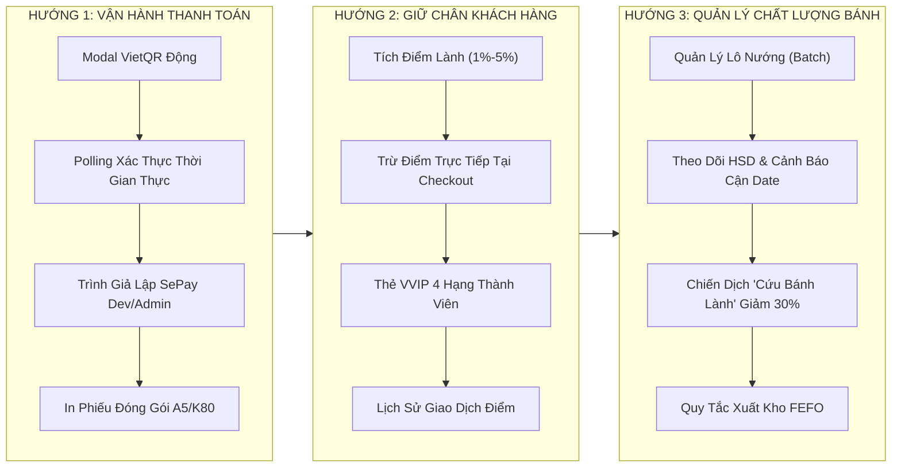
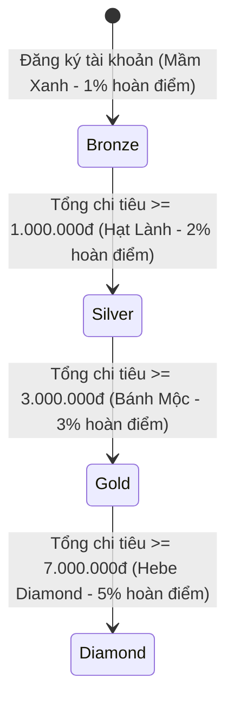
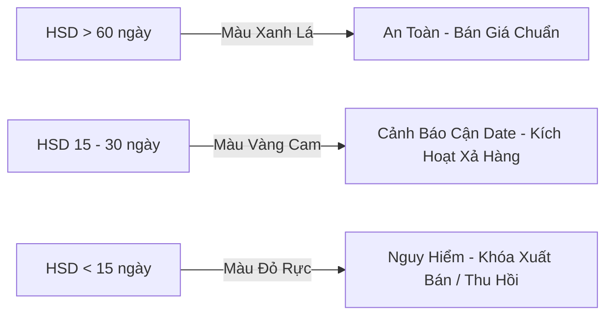

# KẾ HOẠCH TRIỂN KHAI CHI TIẾT: HƯỚNG 1, HƯỚNG 2 VÀ HƯỚNG 3
## HỆ THỐNG THƯƠNG MẠI ĐIỆN TỬ BÁNH DINH DƯỠNG HEBEKERY
*Tài liệu chuẩn bị kỹ thuật & lộ trình mã hóa | Phiên bản 2.0 | Ngày lập: 11/11/2026*

---

## 📌 MỤC LỤC
1. [TỔNG QUAN CHIẾN LƯỢC](#1-tổng-quan-chiến-lược)
2. [HƯỚNG 1: THANH TOÁN TỰ ĐỘNG VIETQR, GIẢ LẬP SEPAY & IN HÓA ĐƠN VẬN HÀNH](#2-hướng-1-thanh-toán-tự-động-vietqr-giả-lập-sepay--in-hóa-đơn-vận-hành)
3. [HƯỚNG 2: HỆ THỐNG KHÁCH HÀNG THÂN THIẾT & TÍCH ĐIỂM ĐỔI QUÀ (LOYALTY & VVIP)](#3-hướng-2-hệ-thống-khách-hàng-thân-thiết--tích-điểm-đổi-quà-loyalty--vvip)
4. [HƯỚNG 3: QUẢN LÝ KHO THEO LÔ BÁNH & HẠN SỬ DỤNG (BATCH & SHELF-LIFE)](#4-hướng-3-quản-lý-kho-theo-lô-bánh--hạn-sử-dụng-batch--shelf-life)
5. [MA TRẬN CÔNG VIỆC THEO TỪNG GIAI ĐOẠN (STEP-BY-STEP IMPLEMENTATION)](#5-ma-trận-công-việc-theo-từng-giai-đoạn-step-by-step-implementation)
6. [TIÊU CHÍ NGHIỆM THU & BỘ BÀI TEST BỔ SUNG (ACCEPTANCE CRITERIA)](#6-tiêu-chí-nghiệm-thu--bộ-bài-test-bổ-sung-acceptance-criteria)

---

## 1. TỔNG QUAN CHIẾN LƯỢC

Sau khi hoàn thành 100% các chức năng cốt lõi (Giai đoạn 1 - 5) cùng các tính năng thương hiệu mở rộng (Hộp bánh Mix-and-match `/box-builder`, Wishlist Hub, Vouchers, Freeship 299k, BMI/TDEE), hệ thống HeBekery cần bước tiếp vào giai đoạn **thực chiến hóa vận hành kinh doanh (Business Automation & Operations)**.

- **Mục tiêu Hướng 1:** Tự động hóa khâu thu tiền qua ngân hàng, triệt tiêu sai sót đối soát thủ công và cung cấp phiếu đóng hàng chuẩn chỉnh cho thợ làm bánh và nhân viên đóng gói.
- **Mục tiêu Hướng 2:** Xây dựng vòng lặp khách hàng quay lại mua hàng định kỳ (Customer Retention) nhờ cơ chế tích điểm thưởng và phân hạng quyền lợi VVIP.
- **Mục tiêu Hướng 3:** Giải quyết bài toán sống còn của ngành bánh ăn kiêng (biscotti, ngũ cốc granola, bánh ngói): bánh nướng mộc tự nhiên không chất bảo quản, thời gian sử dụng ngắn (3 - 6 tháng).

---

## 2. HƯỚNG 1: THANH TOÁN TỰ ĐỘNG VIETQR, GIẢ LẬP SEPAY & IN HÓA ĐƠN VẬN HÀNH

### 2.1. Phân Tích Hiện Trạng Mã Nguồn
- **Đã có:** 
  - Backend đã có [`SepayWebhookController.java`](file:///c:/project/WebBakery/src/main/java/com/example/hebekery/controller/SepayWebhookController.java) và `SepayWebhookService.java`.
  - Có API kiểm tra trạng thái thanh toán: `GET /api/payment/sepay/orders/{orderId}/status`.
  - Database đã có bảng `payment_transactions` lưu lịch sử chuyển khoản.
- **Điểm còn thiếu cần hoàn thiện:**
  1. **Frontend chưa có Popup VietQR trực tiếp:** Khách chọn thanh toán Chuyển khoản (VIETQR / BANK_TRANSFER) tại Checkout nhưng chưa bật modal hiển thị mã QR động chứa sẵn số tiền và mã đơn.
  2. **Chưa có cơ chế Polling tự động tại giao diện chờ:** Khi khách quét mã chuyển tiền thành công trên App ngân hàng, màn hình chưa tự động chuyển sang trang `/order-success/:orderId`.
  3. **Thiếu công cụ Test cho Admin/Developer:** Muốn test webhook phải dùng Postman thủ công hoặc chuyển tiền thật. Cần có trang giả lập bắn webhook nội bộ.
  4. **Chưa có chức năng in phiếu đóng gói (Packing Slip / Bill):** Nhân viên kho không in được hóa đơn chi tiết để dán vào hộp bánh giao cho bưu tá GHTK/GHN.

### 2.2. Giải Pháp Kỹ Thuật Chi Tiết

#### A. Modal VietQR Động & Tự Động Đối Soát (Realtime Polling Modal)
- **API VietQR Napas:**
  Sử dụng chuẩn URL tạo mã QR động của VietQR:
  `https://img.vietqr.io/image/<BANK_ID>-<ACCOUNT_NO>-compact2.png?amount=<AMOUNT>&addInfo=HBK<ORDER_CODE>&accountName=<ACCOUNT_NAME>`
  - Ngân hàng mặc định: MBBank (970422) hoặc Vietcombank (970436).
  - Số tài khoản: Cấu hình qua biến môi trường hoặc bảng cấu hình `app_settings`.
  - Cú pháp nội dung chuyển khoản: `HBK<OrderCode>` (ví dụ: `HBK98234`).
- **Cơ chế Polling trên Frontend (`VietQrPaymentModal.tsx`):**
  - Mở Popup ngay khi đặt hàng thành công với phương thức chuyển khoản.
  - Hiển thị đồng hồ đếm ngược 15:00 phút.
  - Gọi định kỳ `GET /api/payment/sepay/orders/{orderId}/status` mỗi **2.5 giây**.
  - Ngay khi nhận được `paymentStatus === 'PAID'`:
    - Phát âm thanh "Ting ting" hoặc hiệu ứng ăn mừng confetti.
    - Đóng modal và chuyển hướng mượt mà sang `/order-success/:orderId`.

#### B. Trình Giả Lập Bắn Webhook SePay Dành Cho Admin/Dev (`AdminSepaySimulatorPage.tsx`)
- Đường dẫn: `/admin/sepay-simulator` (Chỉ dành cho role `ADMIN`).
- **Giao diện trực quan:**
  - Danh sách đơn hàng đang ở trạng thái `PAYMENT_PENDING`.
  - Bấm chọn đơn hàng -> Form tự động điền sẵn: `referenceCode`, `transferAmount`, `content` (`HBK<OrderCode>`), `gateway`.
  - Nút **"Bắn Webhook Thanh Toán Thành Công"** -> Gửi request nội bộ đến `POST /api/payment/sepay/webhook`.
  - Log kết quả trả về ngay trên màn hình (Status code, message, thời gian xử lý).

#### C. In Phiếu Đóng Gói / Hóa Đơn Chuẩn A5 & K80 (`OrderInvoicePrintModal.tsx`)
- Nút **"In phiếu giao hàng"** được tích hợp trong trang Quản lý đơn hàng Admin (`AdminOrdersPage.tsx`) và trang tra cứu đơn hàng của khách.
- **Bố cục in chuẩn thương mại điện tử:**
  - Header: Logo HeBekery, Hotline `097 97 64 185`, Địa chỉ lò bánh `2D Hồ Ngọc Cẩn, Tân Phú, TP HCM`.
  - Mã vạch / Mã QR Code tra cứu đơn hàng.
  - Thông tin người nhận: Tên, SĐT, Địa chỉ nhận hàng chi tiết.
  - Bảng sản phẩm: Tên bánh, phân loại/vị, số lượng, đơn giá, thành tiền.
  - Bảng thanh toán: Tạm tính, Chiết khấu Voucher, Giảm giá Điểm thưởng, Phí ship (Ghi rõ "Miễn phí Freeship 299k" nếu có), Tổng tiền thu COD (hoặc "ĐÃ THANH TOÁN QUA VIETQR").
  - Ghi chú bảo quản: *"Bánh nướng mộc tự nhiên không chất bảo quản, vui lòng bảo quản ngăn mát tủ lạnh sau khi mở nắp"*.
- **CSS In Ấn Chuyên Nghiệp:** Sử dụng `@media print` ẩn toàn bộ header, sidebar, nút bấm; căn chỉnh vừa vặn khổ A5 ngang hoặc khổ cuộn hóa đơn K80.

---

## 3. HƯỚNG 2: HỆ THỐNG KHÁCH HÀNG THÂN THIẾT & TÍCH ĐIỂM ĐỔI QUÀ (LOYALTY & VVIP)

### 3.1. Phân Tích Hiện Trạng Mã Nguồn
- **Đã có:** 
  - Database đã có bảng `customer_profiles` với các cột: `loyalty_points`, `membership_tier`, `total_spent`, `total_orders`.
  - Entity [`CustomerProfile.java`](file:///c:/project/WebBakery/src/main/java/com/example/hebekery/model/CustomerProfile.java) đã ánh xạ đầy đủ các trường này.
  - Giao diện `ProfilePage.tsx` đã có Tab 5 "Hạng thành viên".
- **Điểm còn thiếu cần hoàn thiện:**
  1. **Chưa có nghiệp vụ cộng điểm tự động:** Khi đơn hàng hoàn tất (`DELIVERED`), hệ thống chưa tự động tính % điểm thưởng để cộng vào `customer_profiles`.
  2. **Chưa có bảng lịch sử giao dịch điểm:** Cần biết điểm được cộng từ đơn hàng nào, tiêu vào đơn hàng nào, thời gian nào.
  3. **Chưa có chức năng tiêu điểm tại Checkout:** Khách hàng có điểm nhưng không có chỗ tick chọn "Dùng điểm giảm giá" khi thanh toán.
  4. **Giao diện Tab 5 còn tĩnh:** Cần biến thành Thẻ Thành Viên Số (Digital Member Card) tương tác sống động, có thanh tiến độ thăng hạng tiếp theo.

### 3.2. Quy Tắc Nghiệp Vụ Tích & Tiêu Điểm

| Cấp Bậc Thành Viên | Tên Thuần Việt | Điều Kiện Chi Tiêu | Tỷ Lệ Hoàn Điểm Lành | Đặc Quyền Độc Quyền |
| :--- | :--- | :--- | :--- | :--- |
| **BRONZE** | **Mầm Xanh** | Khách hàng mới (0đ) | **1%** giá trị đơn hàng | Tích điểm mọi đơn hàng, nhận voucher chào mừng 10%. |
| **SILVER** | **Hạt Lành** | Tích lũy $\ge 1.000.000đ$ | **2%** giá trị đơn hàng | Tặng voucher sinh nhật 50.000đ, ưu tiên giải quyết đơn. |
| **GOLD** | **Bánh Mộc** | Tích lũy $\ge 3.000.000đ$ | **3%** giá trị đơn hàng | Freeship mọi đơn từ 199k, tặng quà bánh mới dùng thử. |
| **DIAMOND** | **Hebe Diamond** | Tích lũy $\ge 7.000.000đ$ | **5%** giá trị đơn hàng | Trợ lý dinh dưỡng riêng, Freeship trọn đời, quà hộp Tết. |

#### A. Quy Tắc Quy Đổi:
- **Tích điểm:** $1\text{ Điểm Lành} = 1.000\text{ VNĐ}$.
  - Ví dụ: Khách hạng Hạt Lành (2%) mua đơn 500.000đ $\rightarrow$ Tích được $\frac{500.000 \times 2\%}{1.000} = 10\text{ điểm}$ (tương đương 10.000đ).
- **Tiêu điểm:** Khách có thể đổi tối đa **30% giá trị đơn hàng** bằng điểm thưởng để tránh tình trạng lạm phát điểm.

#### B. Cấu Trúc Bảng Dữ Liệu Bổ Sung (`loyalty_transactions`)
- `id` (VARCHAR 64, PK)
- `user_id` (VARCHAR 64, FK -> users)
- `order_id` (VARCHAR 64, FK -> orders, nullable)
- `transaction_type` (ENUM: `EARN_PURCHASE`, `REDEEM_CHECKOUT`, `ADMIN_ADJUST`, `BIRTHDAY_GIFT`)
- `points` (INT: số dương nếu cộng, số âm nếu tiêu)
- `balance_after` (INT: số dư điểm sau giao dịch)
- `description` (VARCHAR 255: lý do giao dịch)
- `created_at` (DATETIME)

#### C. Bổ Sung Các Cột Trong Bảng `orders`
- `points_used` (INT, default 0): Số điểm khách đã tiêu cho đơn hàng này.
- `points_discount_amount` (DOUBLE, default 0.0): Số tiền được giảm tương ứng ($points\_used \times 1.000$).
- `points_earned` (INT, default 0): Số điểm tích được sau khi đơn hàng giao thành công.

---

## 4. HƯỚNG 3: QUẢN LÝ KHO THEO LÔ BÁNH & HẠN SỬ DỤNG (BATCH & SHELF-LIFE)

### 4.1. Đặc Thù Bắt Buộc Của Tiệm Bánh Thực Dưỡng HeBekery
Bánh ăn kiêng HeBekery (Biscotti nguyên cám, ngũ cốc nướng mật ong, bánh ngói hạnh nhân keto) được nướng thủ công, **cam kết 100% không dùng chất bảo quản hóa học**. Do đó:
- **Hạn sử dụng tiêu chuẩn:** 3 đến 6 tháng kể từ ngày nướng bánh.
- **Rủi ro lớn nhất trong vận hành tiệm:** Bán nhầm bánh lô cũ cận date cho khách hoặc để bánh quá hạn trong kho dẫn đến phải tiêu hủy lãng phí.
- **Yêu cầu kỹ thuật:** Hệ thống cần kiểm soát chi tiết từng **Lô Sản Xuất (Production Batch)** thay vì chỉ quản lý một con số tồn kho chung chung.

### 4.2. Thiết Kế Cơ Sở Dữ Liệu & Thực Thể `ProductBatch`
Tạo bảng mới `product_batches`:
- `id` (VARCHAR 64, PK): UUID.
- `product_id` (VARCHAR 64, FK -> products): Bánh thuộc lô này.
- `batch_code` (VARCHAR 64, UNIQUE): Ví dụ `LOT-202611-BISC01`.
- `manufacture_date` (DATE): Ngày nướng bánh (NSX).
- `expiry_date` (DATE): Hạn sử dụng (HSD).
- `initial_quantity` (INT): Số lượng nướng ban đầu của lô.
- `current_quantity` (INT): Số lượng hũ/gói còn lại trong kho.
- `status` (ENUM: `ACTIVE`, `NEAR_EXPIRY`, `EXPIRED`, `SOLD_OUT`).
- `discount_percent` (DOUBLE, default 0.0): Tỷ lệ giảm giá cho lô này nếu áp dụng chương trình xả hàng cận date.
- `note` (VARCHAR 500): Ghi chú nhiệt độ nướng hoặc chất lượng mẻ bánh.

### 4.3. Quy Tắc Xuất Kho Chuẩn FEFO (First-Expired, First-Out)
- Khi khách đặt mua sản phẩm, hệ thống tự động ưu tiên gán và trừ số lượng của lô bánh có **Hạn sử dụng gần nhất** trước, đảm bảo dòng xoay kho luôn tươi mới.

### 4.4. Cơ Chế Cảnh Báo Cận Date 3 Cấp Độ

1. **Vùng Xanh (An toàn - HSD > 60 ngày):** Sản phẩm mới nướng, bán nguyên giá niêm yết.
2. **Vùng Vàng (Cận date - HSD từ 15 đến 30 ngày):**
   - Bảng điều khiển Admin Inventory cảnh báo nổi bật.
   - Quản trị viên có thể bật nút **"Kích hoạt Flash Sale Cận Date"** (ví dụ: Giảm ngay 30% - 40%).
   - Ngoài trang chủ & trang danh mục sản phẩm, sản phẩm xuất hiện huy hiệu: **"Lô nướng mộc đợt trước - Tiết kiệm 35% - HSD còn 25 ngày"**.
3. **Vùng Đỏ (Hết hạn hoặc HSD < 15 ngày):**
   - Tự động ngắt hiển thị trên website, không cho khách mua vào giỏ hàng.
   - Chuyển trạng thái sang `EXPIRED` để tạo biên bản hủy hàng hoặc tặng cho nhân viên nội bộ.

---

## 5. MA TRẬN CÔNG VIỆC THEO TỪNG GIAI ĐOẠN (STEP-BY-STEP IMPLEMENTATION)

### 📌 GIAI ĐOẠN A: TRIỂN KHAI HƯỚNG 1 (THANH TOÁN TỰ ĐỘNG & IN VẬN HÀNH)
1. **Bước A1 - Backend VietQR & SePay Polling Enhancements:**
   - Cung cấp API `GET /api/payment/vietqr/generate?orderId=...` trả về URL QR Napas 247 chuẩn mã ngân hàng MBBank, số tiền và cú pháp `HBK<OrderCode>`.
   - Bổ sung SecurityConfig cho phép route polling thanh toán public an toàn.
2. **Bước A2 - Frontend Realtime VietQR Modal:**
   - Tạo component [`VietQrPaymentModal.tsx`](file:///c:/project/WebBakery/web-bakery-frontend/src/components/common/VietQrPaymentModal.tsx).
   - Tích hợp Polling 2.5s vào `CheckoutPage.tsx` và `PublicOrderLookupPage.tsx`.
3. **Bước A3 - Admin SePay Webhook Simulator:**
   - Tạo trang [`AdminSepaySimulatorPage.tsx`](file:///c:/project/WebBakery/web-bakery-frontend/src/features/admin/AdminSepaySimulatorPage.tsx).
   - Thêm liên kết vào sidebar `AdminLayout.tsx` với icon `Zap` hoặc `CreditCard`.
4. **Bước A4 - Phiếu Đóng Gói / Hóa Đơn A5 In Ấn:**
   - Tạo component [`OrderInvoicePrintModal.tsx`](file:///c:/project/WebBakery/web-bakery-frontend/src/features/orders/OrderInvoicePrintModal.tsx) với CSS `@media print`.
   - Thêm nút "In Phiếu Giao Hàng" vào `AdminOrdersPage.tsx`.

---

### 📌 GIAI ĐOẠN B: TRIỂN KHAI HƯỚNG 2 (TÍCH ĐIỂM LÀNH & THẺ THÀNH VIÊN VVIP)
1. **Bước B1 - Database & Migration:**
   - Tạo Liquibase changelog `010-create-loyalty-system.yaml`: Tạo bảng `loyalty_transactions`, thêm cột `points_used`, `points_discount_amount`, `points_earned` vào bảng `orders`.
2. **Bước B2 - Backend Loyalty Service:**
   - Tạo `LoyaltyService.java` và `LoyaltyController.java`:
     - `GET /api/loyalty/profile`: Lấy số dư điểm, hạng hiện tại, tiến độ lên hạng kế tiếp.
     - `GET /api/loyalty/transactions`: Lịch sử tích/tiêu điểm có phân trang.
   - Cập nhật `OrderService.java`:
     - Kiểm tra và trừ điểm khi đặt hàng nếu có `pointsUsed`.
     - Tự động tích điểm theo hạng thành viên khi đơn hàng chuyển sang `DELIVERED`.
3. **Bước B3 - Frontend Tiêu Điểm Tại Checkout:**
   - Cập nhật [`CheckoutPage.tsx`](file:///c:/project/WebBakery/web-bakery-frontend/src/features/checkout/CheckoutPage.tsx): Thêm Card tích chọn "Dùng Điểm Lành", hiển thị số tiền giảm trực tiếp và gửi payload `pointsUsed`.
4. **Bước B4 - Frontend Thẻ VVIP Kỹ Thuật Số (Digital Member Card):**
   - Nâng cấp Tab 5 trong [`ProfilePage.tsx`](file:///c:/project/WebBakery/web-bakery-frontend/src/features/auth/ProfilePage.tsx):
     - Thẻ VIP bóng bẩy với gradient màu theo 4 hạng: Xanh ngọc (Mầm Xanh), Bạc ánh kim (Hạt Lành), Vàng hoàng kim (Bánh Mộc), Đen huyền bí viền vàng (Hebe Diamond).
     - Thanh tiến độ: *"Bạn còn thiếu 420.000đ để thăng hạng Bánh Mộc"*.
     - Bảng lịch sử biến động điểm.

---

### 📌 GIAI ĐOẠN C: TRIỂN KHAI HƯỚNG 3 (QUẢN LÝ KHO LÔ BÁNH & HSD CẬN DATE)
1. **Bước C1 - Database & Entity Lô Bánh:**
   - Tạo Liquibase changelog `011-create-product-batches.yaml`: Bảng `product_batches`.
   - Tạo Entity [`ProductBatch.java`](file:///c:/project/WebBakery/src/main/java/com/example/hebekery/model/ProductBatch.java) và `ProductBatchRepository.java`.
2. **Bước C2 - Backend Batch Service & FEFO Stock Deduction:**
   - Viết `ProductBatchService.java`: CRUD lô sản xuất, cảnh báo lô cận date, tự động tính số ngày còn lại đến HSD.
   - Nâng cấp `OrderService.java`: Khi xác nhận đơn, tự động trừ số lượng của lô có HSD gần nhất (FEFO).
3. **Bước C3 - Giao Diện Admin Quản Lý Lô Bánh:**
   - Thêm tab "Quản Lý Lô Bánh & HSD" trong [`AdminInventoryPage.tsx`](file:///c:/project/WebBakery/web-bakery-frontend/src/features/admin/AdminInventoryPage.tsx).
   - Bộ lọc: Lô còn hạn, Lô cận date (< 30 ngày), Lô hết hạn.
   - Công tắc kích hoạt "Xả hàng cận date" kèm cài đặt % giảm giá.
4. **Bước C4 - Giao Diện Storefront "Cứu Bánh Lành Cận Date":**
   - Hiển thị nhãn cảnh báo thân thiện và mức giá giảm ưu đãi trên thẻ sản phẩm và trang chi tiết bánh.

---

## 6. TIÊU CHÍ NGHIỆM THU & BỘ BÀI TEST BỔ SUNG (ACCEPTANCE CRITERIA)

| Hướng Đi | Nghiệp Vụ Cần Đạt (Definition of Done) | Test Case Kiểm Thử Bắt Buộc |
| :--- | :--- | :--- |
| **Hướng 1** | 1. Modal VietQR hiển thị đúng mã ngân hàng, đúng số tiền đã trừ voucher/điểm, đúng cú pháp `HBK...` 2. Chuyển tiền từ App hoặc giả lập bằng SePay Simulator, trang Checkout tự động nhảy sang Order Success trong vòng 3 giây. 3. Bấm "In Phiếu Giao Hàng" mở trang in sạch sẽ khổ A5/K80, đầy đủ mã vạch, danh sách bánh và tiền thu. | - `SepayWebhookServiceTest`: test xác thực chữ ký API key & đối soát mã đơn. - `VietQrModal.test.tsx`: test polling định kỳ 2.5s và tự đóng khi nhận trạng thái `PAID`. |
| **Hướng 2** | 1. Đơn hàng `DELIVERED` tự động cộng đúng % điểm theo hạng thành viên (1%, 2%, 3%, 5%). 2. Checkout cho phép tick chọn tiêu điểm, giảm tối đa 30% giá trị đơn hàng. 3. Tab 5 Profile hiển thị đúng thẻ hạng, thanh tiến độ và lịch sử biến động điểm. | - `LoyaltyServiceTest`: test tích điểm theo hạng và chặn tiêu điểm vượt quá số dư. - `ProfileLoyaltyTab.test.tsx`: test hiển thị thẻ hạng và thanh tiến độ. |
| **Hướng 3** | 1. Tạo mới lô bánh nướng lưu đúng NSX, HSD. 2. Hệ thống tự động phân loại đúng 3 mức màu: Xanh (> 60d), Vàng (< 30d), Đỏ (< 15d). 3. Đơn hàng tự động trừ lô có HSD gần nhất (FEFO). 4. Khi bật Flash Sale cận date, Storefront hiển thị giá ưu đãi và số ngày HSD còn lại. | - `ProductBatchServiceTest`: test tính ngày cận date và quy tắc trừ kho FEFO. - `AdminBatchManagement.test.tsx`: test tạo lô và bật xả hàng cận date. |

---

*Tài liệu này đã được lưu tại file [`HEBEKERY_HUONG_1_2_3_PLAN.md`](file:///c:/project/WebBakery/HEBEKERY_HUONG_1_2_3_PLAN.md) trong thư mục gốc dự án để toàn đội ngũ đối chiếu và thực hiện tuần tự.*
