# 🥐 Tiệm Bánh Dinh Dưỡng Hebekery

[](https://github.com)
[](https://spring.io/projects/spring-boot)
[](https://www.oracle.com/java/)
[](https://react.dev)
[](https://www.typescriptlang.org/)
[](https://vitejs.dev/)
[](https://tailwindcss.com/)
[](https://www.docker.com/)
[](https://nginx.org/)
[](https://www.mysql.com/)
[](https://www.liquibase.org/)

Hệ thống thương mại điện tử chuyên cung cấp các dòng bánh, hạt và ngũ cốc dinh dưỡng lành mạnh (Eat Clean, Healthy Bakery, Granola, Biscotti, Bánh ngói Keto). Ứng dụng xây dựng trên kiến trúc Single Page Application với **React 19**, **Spring Boot 3.4 RESTful API**, quản lý cơ sở dữ liệu qua **Liquibase**, tự động hóa thanh toán **VietQR Napas 247 qua SePay**, hệ thống khách hàng thân thiết **Điểm Lành & Thẻ VVIP 4 Hạng**, quản lý hạn sử dụng & lô sản xuất **FEFO**, cùng trọn bộ đóng gói Docker Compose.

---

## 🌟 Tính năng nổi bật & 3 Hướng phát triển chiến lược

1. **Tự động hóa thanh toán VietQR Napas 247 & Công cụ Giả lập SePay & In Hóa đơn A5 / K80**:
   - Tự sinh mã VietQR Napas 247 động kèm số tiền và mã đơn hàng định danh `HBK{orderCode}`.
   - Polling trạng thái thời gian thực và xử lý Webhook SePay bảo mật đa lớp (Idempotent, Signature).
   - Công cụ mô phỏng Webhook SePay dành riêng cho Admin/Dev để kiểm thử dòng tiền 1-click.
   - Modal in hóa đơn và phiếu giao hàng hỗ trợ song song chuẩn in nhiệt K80 và khổ A5 văn phòng.

2. **Điểm Lành HeBekery & Thẻ Hội Viên Điện Tử VVIP 4 Hạng**:
   - 4 hạng hội viên đặc quyền: **Mầm Xanh (1%)**, **Hạt Lành (2%)**, **Bánh Mộc (3%)**, **Hebe Diamond (5%)**.
   - Tự động tích lũy Điểm Lành khi đơn hàng giao thành công (`DELIVERED` hoặc người dùng xác nhận nhận hàng).
   - Khấu trừ tiêu điểm trực tiếp tại bước thanh toán: **1 điểm = 1.000đ** (tối đa 30% giá trị đơn hàng).
   - Thẻ thành viên số phong cách kim loại sang trọng (Digital Luxury Card) với hiệu ứng chip dập nổi, thanh tiến độ nâng hạng và lịch sử giao dịch điểm minh bạch.

3. **Quản Lý Lô Bánh & Hạn Sử Dụng FEFO & Flash Sale "Cứu Bánh Lành Cận Date"**:
   - Quản lý lô sản xuất bánh (`product_batches`), ngày ra lò, hạn sử dụng và số lượng thực tế.
   - Cơ chế xuất kho thông minh **FEFO (First-Expired, First-Out)**: tự động ưu tiên xuất lô cận date trước.
   - Hệ thống cảnh báo hạn dùng 3 mức: 🟢 An toàn (>60 ngày), 🟡 Cần chú ý (15-30 ngày), 🔴 Khẩn cấp (<15 ngày).
   - Chiến dịch Flash Sale xả nhanh lô bánh cận date với huy hiệu lửa `🔥 Cứu Bánh -X%` đồng bộ từ Trang chủ, Danh mục, Chi tiết sản phẩm đến Giỏ hàng.

---

## 📸 Hình ảnh giao diện thực tế (Screenshots)

### 1. Trang chủ HeBekery (Chuẩn nhận diện thương hiệu Warm Organic & Hero Slider)
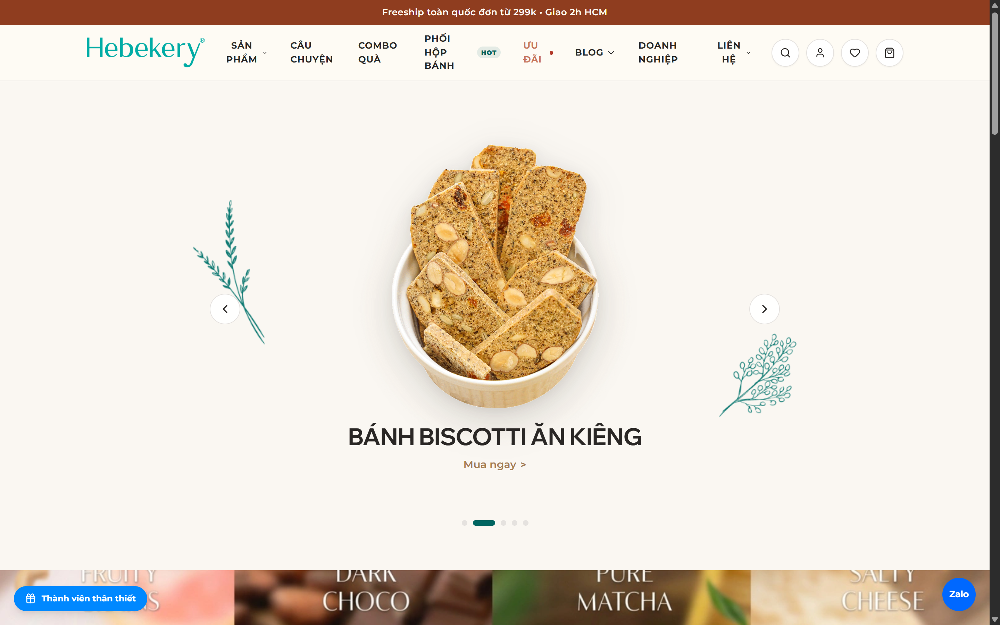

### 2. Thực đơn bánh dinh dưỡng & Huy hiệu Flash Sale Cận Date
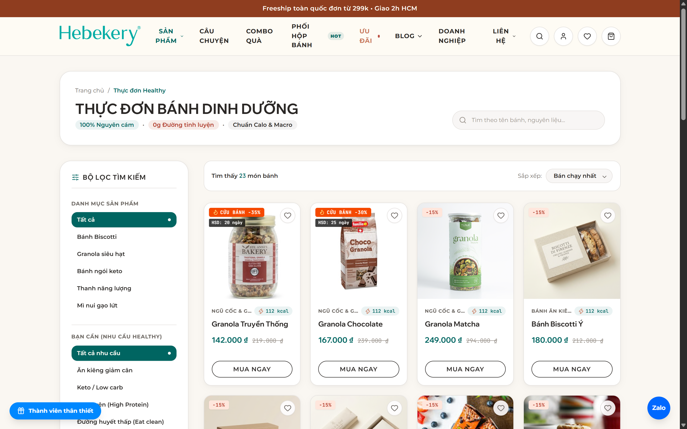

### 3. Trang chi tiết sản phẩm & Ưu đãi Flash Sale Cận Date
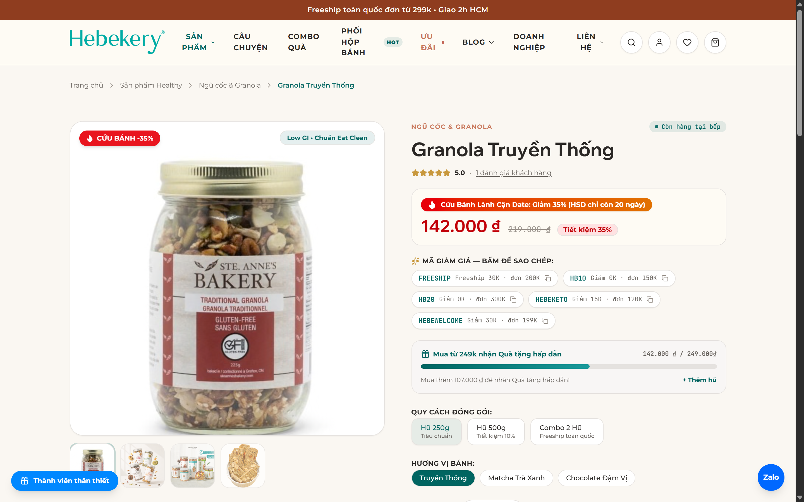

### 4. Thẻ Hội Viên Điện Tử VVIP & Hệ thống Điểm Lành HeBekery (Tab 5 Profile)
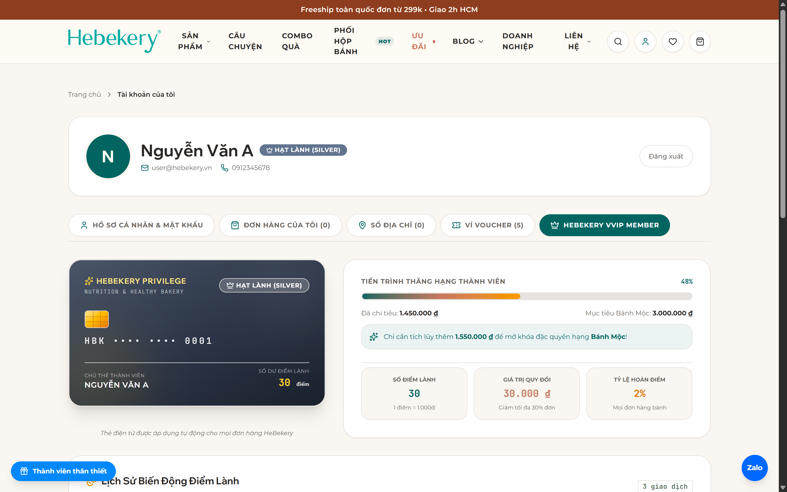

### 5. Tiêu Điểm Lành HeBekery tại Checkout & Thanh toán VietQR Napas 247
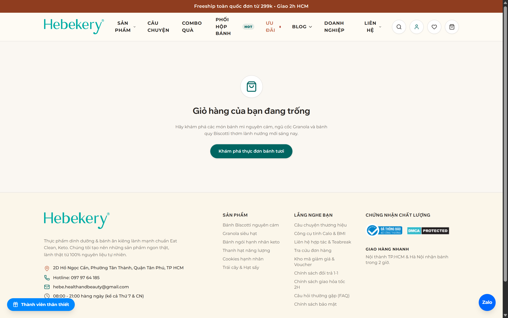

### 6. Quản Lý Lô Bánh & Hạn Sử Dụng FEFO (Admin Inventory)
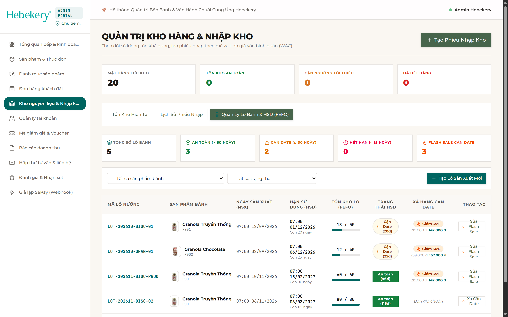

### 7. Công cụ Giả lập Webhook SePay cho Quản trị viên
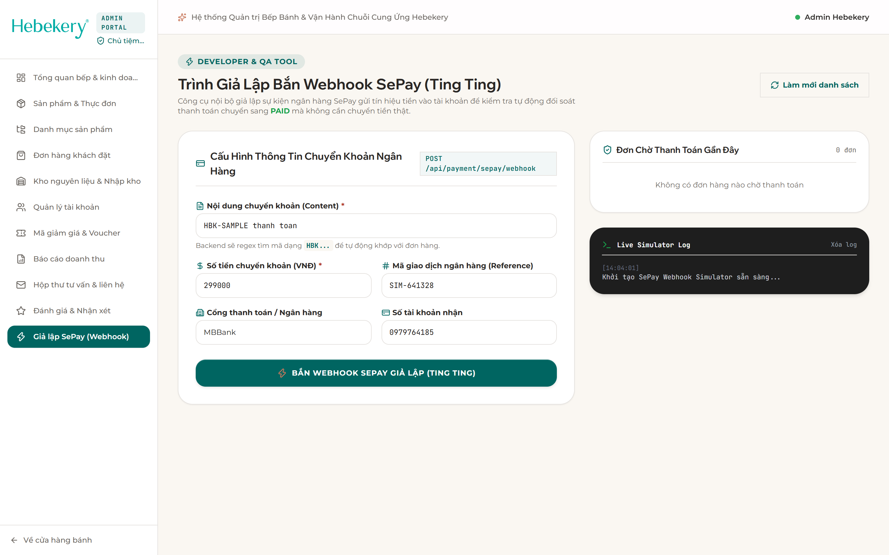

### 8. Quản trị đơn hàng & In Phiếu Giao Hàng A5 / K80
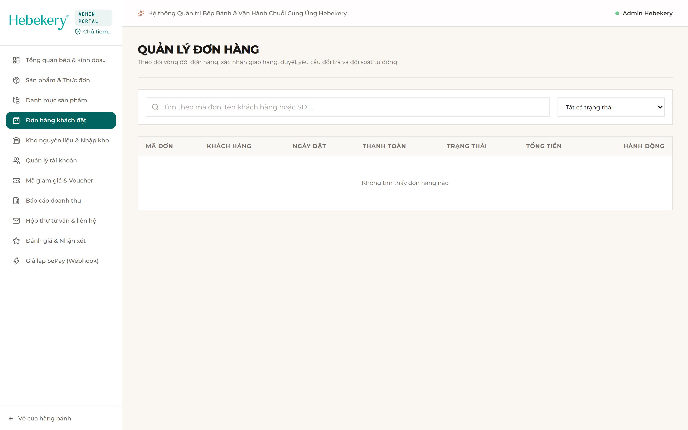

### 9. Tự làm Hộp Bánh Mix Vị HeBekery (Custom Box Builder)
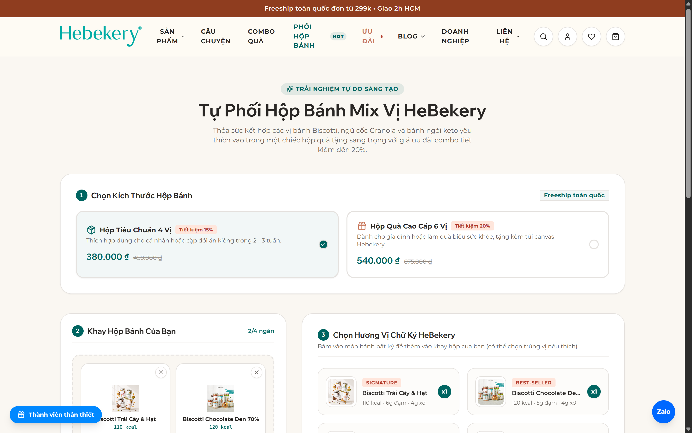

### 10. Công cụ tính BMI, TDEE & Gợi ý thực đơn Eat Clean
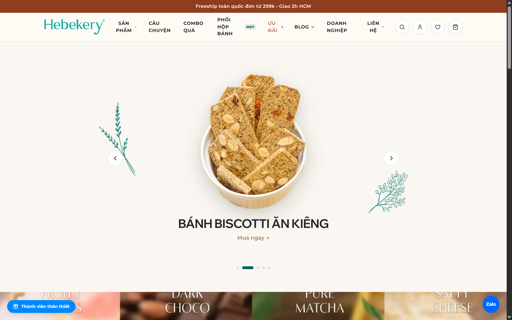

### 11. Tra cứu đơn hàng công khai & Tài liệu Swagger OpenAPI
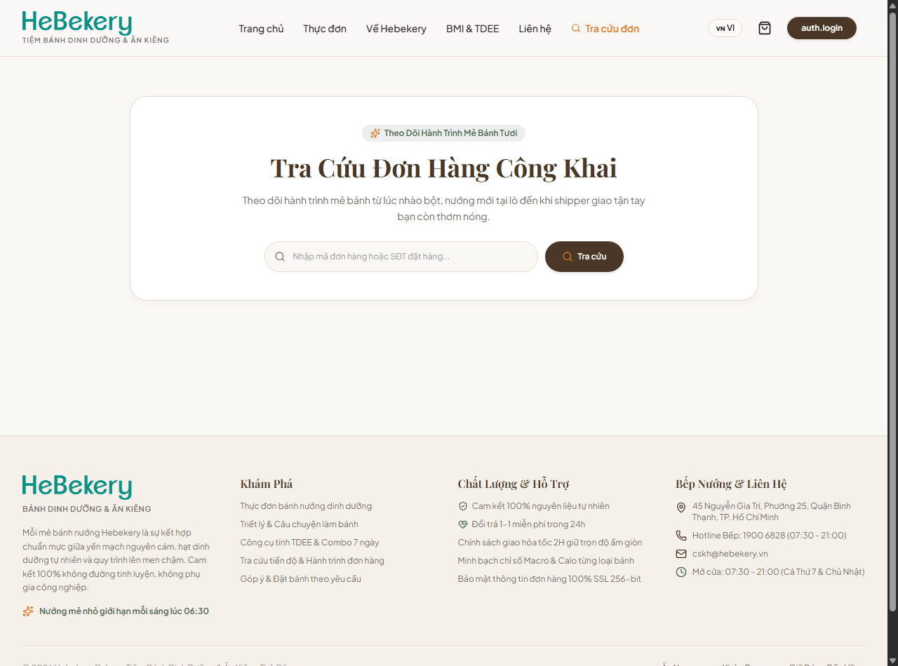
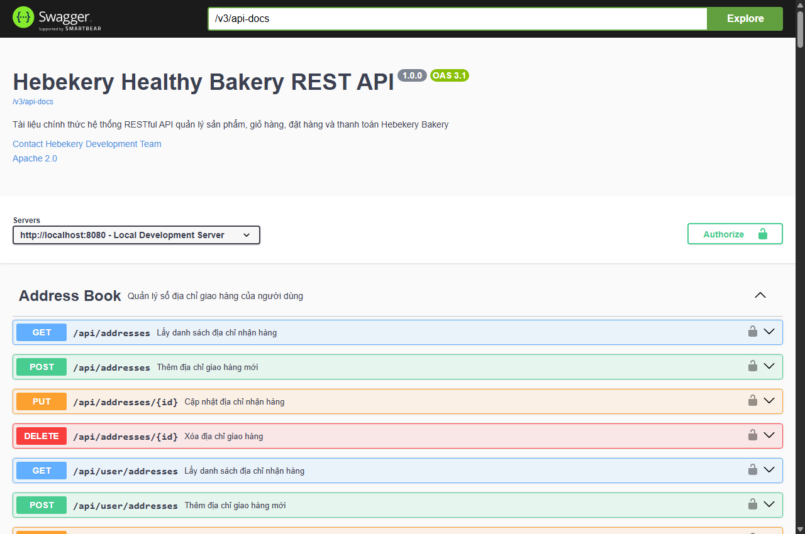

---

## ⚡ Hướng dẫn khởi chạy nhanh (Quick Start)

### Cách 1: Khởi chạy 1 lệnh với Docker Compose (Khuyến nghị)

Chỉ cần máy bạn đã cài **Docker Desktop**:

```bash
# 1. Tạo file cấu hình môi trường từ mẫu
cp .env.example .env

# 2. Khởi chạy toàn bộ hệ thống (MySQL, Backend, Frontend, Nginx Gateway)
docker compose up -d --build
```

Sau khi chạy xong, mở trình duyệt truy cập:
- 🌐 **Website**: [http://localhost](http://localhost)
- 📑 **Swagger API Docs**: [http://localhost/swagger-ui/index.html](http://localhost/swagger-ui/index.html)

---

### Cách 2: Chạy môi trường phát triển cục bộ (Local Dev)

Yêu cầu: **JDK 17+**, **Node.js 22+**, **MySQL 8.0+** (đã tạo database `hebekery`).

**1. Khởi chạy Backend (Spring Boot 3.4)**
```bash
./mvnw clean spring-boot:run
```
> Backend chạy tại: `http://localhost:8080` (Tự động nạp dữ liệu mẫu ban đầu qua Liquibase).

**2. Khởi chạy Frontend (React 19 Vite)**
```bash
cd web-bakery-frontend
npm install
npm run dev
```
> Frontend chạy tại: `http://localhost:3000` (hoặc `http://localhost:5173`).

---

## 👥 Tài khoản thử nghiệm phân quyền (RBAC)

| Vai trò | Email đăng nhập | Mật khẩu | Phạm vi quyền hạn |
| :--- | :--- | :--- | :--- |
| **Quản trị viên (`ADMIN`)** | `admin@hebekery.vn` | `admin123` | Toàn quyền hệ thống: Lô hàng FEFO, SePay Simulator, Người dùng, Đơn hàng, Voucher, Doanh thu |
| **Nhân viên Sale (`STAFF_SALES`)** | `sales@hebekery.vn` | `123456` | Tiếp nhận đơn hàng, in phiếu xuất kho K80/A5, tạo vận đơn, chăm sóc khách hàng |
| **Nhân viên Kho (`STAFF_WAREHOUSE`)** | `warehouse@hebekery.vn` | `123456` | Quản lý sản phẩm, danh mục, xuất nhập kho theo hạn sử dụng FEFO |
| **Khách hàng (`USER`)** | `user@hebekery.vn` | `123456` | Mua hàng, tích & tiêu Điểm Lành, Thẻ VVIP, đánh giá sản phẩm, tra cứu đơn hàng |

---

## 💳 Cấu hình SePay Webhook (Thanh toán VietQR)

Khi kết nối với cổng thanh toán SePay:
- **Tên Webhook**: `Hebekery Webhook Prod`
- **URL nhận Webhook**:
  - *Môi trường Local (dùng ngrok/tunnel)*: `https://<subdomain>.ngrok-free.app/api/payment/sepay/webhook`
  - *Môi trường Production*: `https://your-domain.com/api/payment/sepay/webhook`
  - *Test nội bộ qua Simulator*: truy cập trực tiếp `/admin/sepay-simulator`
- **Xác thực API Key**: Điền API Key của SePay vào biến `SEPAY_WEBHOOK_API_KEY` trong file `.env`.

---

## 🛠️ Công nghệ sử dụng

- **Frontend**: React 19, TypeScript, Vite, Tailwind CSS, Lucide Icons, React Query, Motion, Vitest.
- **Backend**: Spring Boot 3.4.x (Java 17), Spring Security 6 (JWT & RBAC), Spring Data JPA, Liquibase Database Migration.
- **Media CDN**: Cloudinary CDN lưu trữ ảnh sản phẩm chất lượng cao.
- **Thanh toán & Tích điểm**: VietQR Napas 247, SePay Webhook tự động, Điểm Lành HeBekery.
- **Quản lý kho**: Thuật toán FEFO (First-Expired, First-Out), cảnh báo 3 cấp độ hạn sử dụng.
- **Hạ tầng**: Docker, Docker Compose (4 containers: MySQL 8, Backend, Frontend, Nginx Reverse Proxy Gateway).

---

## 🧪 Kiểm thử tự động (Automated Tests)

- **Backend**: **119/119** JUnit 5 & MockMvc tests Passed (100% `BUILD SUCCESS`).
- **Frontend**: **29/29** Vitest tests across 9 test suites Passed (100%).
- **TypeScript**: `npx tsc -b` kiểm tra biên dịch 0 lỗi.
- **CI/CD**: Tự động kiểm thử qua GitHub Actions trên mỗi lần đẩy mã nguồn.
