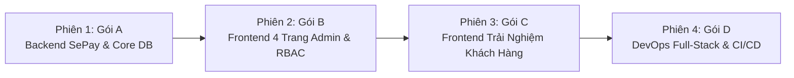

# KẾ HOẠCH GIAI ĐOẠN 5: HOÀN THIỆN TOÀN DIỆN HỆ THỐNG HEBEKERY
## RÀ SOÁT, TÁI CẤU TRÚC VÀ LẤP ĐẦY KHOẢNG CÁCH NGHIỆP VỤ ĐA VAI TRÒ (FULL-STACK ENTERPRISE AUDIT & ROADMAP)

> **Mục tiêu**: Thực hiện rà soát chuyên sâu toàn bộ hệ thống từ Backend, Frontend đến DevOps; đối chiếu 100% với tài liệu **`docs/NGHIEP_VU_TOAN_BO_DU_AN.md`** (Phương án B - Phiên bản 2.0) và bộ quy tắc **`RULES.md`**; xây dựng danh mục các đầu việc (actionable tasks) chi tiết, không bỏ sót bất kỳ tính năng, phân quyền hay trang nghiệp vụ nào của 5 nhóm người dùng (`Guest`, `ROLE_USER`, `ROLE_STAFF_WAREHOUSE`, `ROLE_STAFF_SALES`, `ROLE_ADMIN`).
> **Nguyên tắc triển khai**: Tuyệt đối không làm qua loa, kiểm soát chất lượng bằng kiểm thử tự động, chuẩn hóa giao diện kiến trúc tối giản xúc giác (Minimalist & Tactile UI).

---

## PHẦN 1: BẢNG TỔNG HỢP RÀ SOÁT HIỆN TRẠNG & KHOẢNG CÁCH (GAP ANALYSIS)

Qua quá trình rà soát 19 Controller Java, 13 bảng Liquibase MySQL, 42 component/page React TypeScript và toàn bộ luồng nghiệp vụ của hệ thống, các khoảng cách chính được tổng hợp chi tiết như sau:

| Hạng mục | Đã hoàn thành (Giai đoạn 1 - 4) | Còn thiếu sót / Tồn đọng (Cần hoàn thiện) | Mức độ ưu tiên |
| :--- | :--- | :--- | :---: |
| **1. Webhook SePay & Đối soát VietQR** | • Cấu hình `SepayConfig`, sinh link ảnh VietQR tĩnh/động.<br>• Cho phép `/api/payment/sepay/webhook` qua `SecurityConfig`. | • **Chưa có `SepayWebhookController`** để tiếp nhận Webhook SePay.<br>• Chưa có cơ chế Regex bóc tách mã đơn `HBK{id}`, kiểm tra idempotency (`referenceCode`), xác thực API Key.<br>• Chưa có API Polling để Frontend tự động biết đơn đã được chuyển sang `PAID`. | **P0 (Cực kỳ quan trọng)** |
| **2. Phân quyền Đa vai trò (RBAC) trên Frontend** | • Spring Security Backend hỗ trợ 4 roles: `ADMIN`, `STAFF_WAREHOUSE`, `STAFF_SALES`, `USER`. | • `ProtectedRoute.tsx` trên Frontend hiện chỉ nhận diện `ADMIN` hoặc `USER`; các role `STAFF_SALES`, `STAFF_WAREHOUSE` bị chặn hoàn toàn khi vào `/admin`.<br>• Sidebar `AdminLayout` chưa lọc menu theo vai trò (Thủ kho vẫn thấy menu Doanh thu; Sales vẫn thấy Nhập kho). | **P0** |
| **3. Trang Quản trị (Admin SPA Pages)** | • Đã có `AdminDashboardPage`, `AdminProductsPage`, `AdminOrdersPage`. | • **Thiếu 4 trang chuyên trách**: 3 route `/admin/inventory`, `/admin/users`, `/admin/reports` đang trỏ tạm (placeholder) về trang khác; hoàn toàn chưa có trang `/admin/contacts` quản lý tin nhắn liên hệ. | **P0** |
| **4. Trải nghiệm Khách hàng (Storefront UX)** | • Xem Catalog, Giỏ hàng, Đặt hàng COD/VietQR, Tính BMI/TDEE, Theo dõi đơn cá nhân. | • Chưa tích hợp Sổ địa chỉ (`AddressSelector`) vào `CheckoutPage` và `ProfilePage`.<br>• Modal VietQR thiếu đếm ngược 15:00 và Polling đối soát realtime.<br>• Chưa có nút "Đã nhận hàng" và Modal đánh giá sao `ProductReview` (1-5 sao).<br>• Trang BMI/TDEE chưa có nút 1-Click "Thêm trọn bộ thực đơn tuần vào giỏ".<br>• Khách vãng lai (Guest) chưa có trang tra cứu đơn hàng công khai bằng SĐT/Mã đơn mà không cần login.<br>• Form `/contact` chưa kết nối API Backend. | **P1 (Quan trọng)** |
| **5. CSDL & Liquibase Schema nâng cao** | • 13 bảng: `users`, `categories`, `products`, `orders`, `order_items`, `cart_items`, `addresses`, `contact_messages`, `purchase_receipts`, `inventory_transactions`, `product_reviews`, `order_status_history`, `return_history`. | • Chưa có bảng `payment_transactions` (lưu vết giao dịch ngân hàng & chống webhook trùng).<br>• Chưa có bảng `customer_profiles` (điểm tích lũy loyalty, hạng thành viên).<br>• Chưa có bảng `vouchers` & `voucher_usages` (động cơ mã giảm giá).<br>• Chưa có bảng `product_batches` (Lô sản xuất & HSD FEFO) và `damaged_goods_receipts` (phiếu hủy hỏng). | **P1** |
| **6. DevOps & Triển khai Full-Stack** | • Container MySQL 8.0, Backend Spring Boot, Nginx Reverse Proxy cơ bản. | • Nginx chỉ proxy pass vào Backend 8080, chưa phục vụ file tĩnh của React SPA (`dist/`) tại route gốc `/` kèm cơ chế fallback `try_files $uri $uri/ /index.html;`.<br>• Chưa có multi-stage build cho Frontend trong `docker-compose.yml`.<br>• Chưa có workflow CI/CD GitHub Actions chạy kiểm thử tự động toàn diện. | **P1** |

---

## PHẦN 2: MA TRẬN PHÂN QUYỀN 5 VAI TRÒ & TIÊU CHÍ NGHIỆM THU

Căn cứ Mục 2 của `docs/NGHIEP_VU_TOAN_BO_DU_AN.md`, hệ thống phải đáp ứng chính xác quyền hạn của 5 nhóm người dùng:

```mermaid
graph TD
    subgraph ROLES["5 NHÓM NGƯỜI DÙNG"]
        GUEST["Khách Vãng Lai (Guest)"]
        USER["Khách Thành Viên (ROLE_USER)"]
        STAFF_SALES["Nhân Viên Sales & CSKH (ROLE_STAFF_SALES)"]
        STAFF_WH["Thủ Kho & Bếp Bánh (ROLE_STAFF_WAREHOUSE)"]
        ADMIN["Chủ Tiệm (ROLE_ADMIN)"]
    end

    subgraph CLIENT_PAGES["GIAO DIỆN STOREFRONT"]
        P_HOME["Trang Chủ, Catalog, Dinh Dưỡng"]
        P_BMI["Máy tính BMI/TDEE + Gợi ý Thực đơn"]
        P_TRACK_PUBLIC["Tra Cứu Đơn Công Khai (SĐT/Mã đơn)"]
        P_CHECKOUT["Thanh Toán COD & VietQR (Có Sổ Địa Chỉ)"]
        P_ORDERS["Lịch Sử Đơn, Xác Nhận Nhận Hàng, Đánh Giá, Đổi Trả"]
        P_PROFILE["Hồ Sơ, Sổ Địa Chỉ, Điểm Thưởng"]
    end

    subgraph ADMIN_PAGES["GIAO DIỆN QUẢN TRỊ ADMIN / STAFF"]
        A_DASH["Dashboard Chỉ Số Tổng Quan"]
        A_ORDERS["Duyệt Đơn, Vận Đơn, Đổi Trả"]
        A_CONTACTS["Hộp Thư CSKH & Phản Hồi Khách"]
        A_INVENTORY["Kho Hàng, Nhập Kho WAC, Cảnh Báo Tồn"]
        A_PRODUCTS["Quản Lý Danh Mục & Sản Phẩm (Cloudinary)"]
        A_USERS["Phân Quyền, Khóa/Mở User, Reset Password"]
        A_REPORTS["Báo Cáo Doanh Thu, Lợi Nhuận P&L, Xuất CSV/PDF"]
    end

    GUEST --> P_HOME
    GUEST --> P_BMI
    GUEST --> P_TRACK_PUBLIC

    USER --> P_HOME
    USER --> P_BMI
    USER --> P_CHECKOUT
    USER --> P_ORDERS
    USER --> P_PROFILE

    STAFF_SALES --> A_ORDERS
    STAFF_SALES --> A_CONTACTS

    STAFF_WH --> A_INVENTORY

    ADMIN --> A_DASH
    ADMIN --> A_ORDERS
    ADMIN --> A_CONTACTS
    ADMIN --> A_INVENTORY
    ADMIN --> A_PRODUCTS
    ADMIN --> A_USERS
    ADMIN --> A_REPORTS
```



### Bảng Ma trận Quyền hạn Chi tiết:

| Chức năng chi tiết | Khách (Guest) | Khách quen (`ROLE_USER`) | CSKH (`STAFF_SALES`) | Thủ kho (`STAFF_WAREHOUSE`) | Chủ tiệm (`ADMIN`) |
| :--- | :---: | :---: | :---: | :---: | :---: |
| **Xem sản phẩm, lọc danh mục, xem Calo/Macro** | ✅ | ✅ | ✅ | ✅ | ✅ |
| **Tính BMI/TDEE & bấm 1-Click thêm thực đơn tuần** | ✅ *(Lưu LocalStorage)* | ✅ *(Đồng bộ Giỏ)* | ✅ | ✅ | ✅ |
| **Tra cứu đơn hàng bằng SĐT hoặc Mã đơn công khai** | ✅ *(Không cần login)* | ✅ *(Xem trực tiếp)* | ✅ *(Toàn bộ đơn)* | ❌ *(Bị chặn)* | ✅ *(Toàn bộ đơn)* |
| **Đặt hàng VietQR / COD kèm chọn Sổ địa chỉ** | ❌ *(Chuyển đăng nhập)* | ✅ | ❌ | ❌ | ❌ |
| **Quét VietQR có đồng hồ 15:00 và tự động chuyển trang khi SePay báo tiền vào** | ❌ | ✅ | ❌ | ❌ | ❌ |
| **Bấm "Đã nhận hàng" & Viết Đánh giá sao (1-5 sao)** | ❌ | ✅ *(Đơn của mình)* | ❌ | ❌ | ❌ |
| **Yêu cầu đổi trả bánh lỗi kèm lý do** | ❌ | ✅ *(Đơn của mình)* | Tiếp nhận | ❌ | Duyệt / Từ chối |
| **Quản lý Sổ địa chỉ nhận hàng cá nhân trong Profile** | ❌ | ✅ | ❌ | ❌ | ❌ |
| **Duyệt đơn COD, tạo mã vận đơn (GHN/GHTK), in đơn** | ❌ | ❌ | ✅ | ❌ | ✅ |
| **Xem & Trả lời tin nhắn phản hồi của khách hàng** | Gửi tin liên hệ | Gửi tin liên hệ | ✅ | ❌ | ✅ |
| **Xem danh sách tồn kho & Cảnh báo chạm ngưỡng tối thiểu** | ❌ | ❌ | ❌ | ✅ | ✅ |
| **Tạo phiếu nhập kho (Dynamic Field Array) & Tính WAC** | ❌ | ❌ | ❌ | ✅ | ✅ |
| **Thêm, sửa, xóa sản phẩm & Upload ảnh Cloudinary** | ❌ | ❌ | ❌ | ❌ | ✅ |
| **Xem danh sách tài khoản, đổi Role, khóa/mở, reset pass** | ❌ | ❌ | ❌ | ❌ | ✅ |
| **Xem biểu đồ P&L, Doanh thu, Lợi nhuận gộp, xuất CSV/PDF** | ❌ | ❌ | ❌ *(Bị chặn)* | ❌ *(Bị chặn)* | ✅ |

---

## PHẦN 3: GÓI TASK CHI TIẾT CẦN XỬ LÝ (ACTIONABLE WORK PACKAGES)

---

### GÓI TASK A: BACKEND CORE - SEPAY WEBHOOK, POLLING & NÂNG CẤP CƠ SỞ DỮ LIỆU

> **Mục tiêu**: Xây dựng hoàn chỉnh luồng thanh toán tự động không chạm (Zero-touch Payment) qua VietQR & SePay Webhook; bổ sung API kiểm tra trạng thái đơn phục vụ Polling; đảm bảo tính toàn vẹn dữ liệu (Idempotency) và quản lý bảng nâng cao theo đúng bản thiết kế.

- [ ] **Task A.1: Xây dựng SePay Webhook Controller & Service**
  - **File tạo mới**:
    - `src/main/java/com/example/hebekery/dto/request/SepayWebhookPayload.java`
    - `src/main/java/com/example/hebekery/controller/SepayWebhookController.java`
    - `src/main/java/com/example/hebekery/service/SepayWebhookService.java`
  - **Nghiệp vụ chi tiết**:
    1. Endpoint: `POST /api/payment/sepay/webhook` (Public, đã cấu hình trong `SecurityConfig.java`).
    2. Xác thực bảo mật: So khớp header `Authorization: Apikey <SEPAY_WEBHOOK_API_KEY>` với giá trị cấu hình trong `application.properties`. Trả về `401 Unauthorized` nếu sai key.
    3. Trích xuất Regex mã đơn hàng từ trường `content`: `(HBK[-_A-Za-z0-9]+|HBK\d+)` hoặc khớp theo ID đơn hàng.
    4. Kiểm tra tính hợp lệ giao dịch:
       - `transferType` phải là `"in"`.
       - `transferAmount` $\ge$ `order.getTotal()`.
       - Đơn hàng đang ở trạng thái `PENDING` hoặc `AWAITING_PAYMENT`.
    5. **Chống trùng lặp (Idempotency)**:
       - Lưu `referenceCode` vào bảng giao dịch thanh toán (`payment_transactions`). Nếu `referenceCode` đã tồn tại -> Trả về HTTP 200 thông báo đã xử lý thành công trước đó (tránh trừ kho hai lần).
    6. **Cập nhật trạng thái đơn**:
       - `order.setPaymentStatus("PAID")`.
       - `order.setOrderStatus("PROCESSING")`.
       - Ghi vết vào `order_status_history` với `changed_by = "SEPAY_WEBHOOK"`.
    7. Trừ kho sản phẩm chính thức nếu đơn trước đó chưa trừ kho.
  - **Tiêu chí nghiệm thu (Acceptance Criteria)**:
    - Gửi request giả lập Webhook SePay qua Postman/cURL với Header đúng -> Đơn hàng chuyển sang `PAID`, tồn kho giảm đúng số lượng, trả về `{ "success": true, "message": "Thanh toán thành công" }`.
    - Gửi request sai API Key -> Trả về HTTP 401.
    - Gửi lặp lại cùng một payload -> Không trừ kho lặp lại, trả về HTTP 200.

- [ ] **Task A.2: Xây dựng Endpoint Polling Kiểm tra Trạng thái Đơn hàng**
  - **File cập nhật**: `src/main/java/com/example/hebekery/controller/CheckoutController.java`
  - **Endpoint bổ sung**: `GET /api/checkout/orders/{orderId}/status` (hoặc `GET /api/payment/status/{orderId}`)
  - **Dữ liệu trả về**:
    ```json
    {
      "orderId": "ORD-123456",
      "orderCode": "HBK-20261105-ABC",
      "orderStatus": "PROCESSING",
      "paymentStatus": "PAID",
      "isPaid": true
    }
    ```
  - **Mục đích**: Để giao diện Modal VietQR trên React Frontend có thể gọi định kỳ (mỗi 3 giây) kiểm tra xem đơn hàng đã được ngân hàng xác nhận hay chưa, tự động đóng popup và thông báo thành công.

- [ ] **Task A.3: Tác vụ Quét Tự động Hủy Đơn VietQR Quá Hạn (Scheduled Task)**
  - **File tạo mới**: `src/main/java/com/example/hebekery/scheduler/OrderCleanupScheduler.java`
  - **Nghiệp vụ**:
    - Bật `@EnableScheduling` trong cấu hình Spring Boot.
    - Chạy định kỳ mỗi 5 phút: Quét các đơn hàng có phương thức `VIETQR`, `paymentStatus = 'PENDING'`, tạo trước thời điểm hiện tại $> 15$ phút.
    - Cập nhật trạng thái đơn sang `CANCELLED`, hoàn lại số lượng tồn kho tạm giữ (nếu có), ghi log lý do: *"Hết hạn 15 phút thanh toán VietQR"*.

- [ ] **Task A.4: Cập nhật Phân quyền RBAC cho `AdminContactController`**
  - **File cập nhật**: `src/main/java/com/example/hebekery/controller/AdminContactController.java`
  - **Chi tiết**: Thay đổi `@PreAuthorize("hasRole('ADMIN')")` thành `@PreAuthorize("hasAnyRole('ADMIN', 'STAFF_SALES')")` để nhân viên CSKH (`STAFF_SALES`) có quyền tiếp nhận và phản hồi tin nhắn của khách hàng theo đúng ma trận nghiệp vụ.

- [ ] **Task A.5: Bổ sung Bảng CSDL Nâng cao qua Liquibase ChangeSet 005**
  - **File tạo mới**: `src/main/resources/db/changelog/changes/005-add-enterprise-tables.yaml`
  - **Cập nhật Master**: Khai báo `005-add-enterprise-tables.yaml` vào `db.changelog-master.yaml`.
  - **Các bảng bổ sung theo Thiết kế Doanh nghiệp (Phần 11)**:
    1. `payment_transactions`: Lưu lịch sử giao dịch webhook SePay (`id`, `order_id`, `reference_code`, `gateway`, `amount`, `content`, `transaction_date`, `created_at`). Đánh chỉ mục UNIQUE trên `reference_code`.
    2. `customer_profiles`: Lưu hồ sơ khách thân thiết (`id`, `user_id`, `loyalty_points`, `membership_tier`, `total_spent`, `target_calories`).
    3. `vouchers`: Lưu mã giảm giá (`id`, `code`, `discount_type`, `discount_value`, `max_discount`, `min_order_amount`, `usage_limit`, `used_count`, `start_date`, `end_date`, `active`).
    4. `voucher_usages`: Lưu vết khách dùng voucher (`id`, `voucher_id`, `user_id`, `order_id`, `used_at`).
  - **Mô hình JPA Entity & Repository tương ứng**:
    - `PaymentTransaction.java`, `PaymentTransactionRepository.java`.
    - `CustomerProfile.java`, `CustomerProfileRepository.java`.
    - `Voucher.java`, `VoucherRepository.java`.

- [ ] **Task A.6: Viết Bộ Unit & Integration Tests cho Backend Mới**
  - **File tạo mới**:
    - `src/test/java/com/example/hebekery/controller/SepayWebhookControllerTest.java`: Test xác thực header Apikey, test chuyển đơn sang PAID thành công, test idempotency khi bắn trùng referenceCode, test sai số tiền.
    - `src/test/java/com/example/hebekery/scheduler/OrderCleanupSchedulerTest.java`: Test tự động quét và hủy đơn VietQR quá hạn 15 phút.
  - Chạy `mvn test` đảm bảo 100% test pass.

---

### GÓI TASK B: FRONTEND ADMIN - 4 TRANG CHUYÊN TRÁCH & PHÂN QUYỀN ĐA VAI TRÒ

> **Mục tiêu**: Xóa bỏ hoàn toàn tình trạng redirect tạm bợ; xây dựng 4 trang chuyên trách chuẩn mực cho Admin & Staff; nâng cấp cơ chế kiểm soát tuyến đường `ProtectedRoute` và Sidebar `AdminLayout` đáp ứng hoàn hảo 3 nhóm vai trò quản trị (`ADMIN`, `STAFF_WAREHOUSE`, `STAFF_SALES`).

- [ ] **Task B.1: Nâng cấp Phân quyền Giao diện Đa Vai trò (`ProtectedRoute` & `AdminLayout`)**
  - **File cập nhật**:
    - `web-bakery-frontend/src/components/common/ProtectedRoute.tsx`
    - `web-bakery-frontend/src/components/layout/AdminLayout.tsx`
    - `web-bakery-frontend/src/routes/AppRoutes.tsx`
  - **Nghiệp vụ chi tiết**:
    1. Mở rộng prop `requiredRole` trong `ProtectedRoute.tsx` hỗ trợ mảng `allowedRoles?: Array<'ADMIN' | 'STAFF_WAREHOUSE' | 'STAFF_SALES' | 'USER'>`.
    2. Phân nhánh điều hướng Sidebar trong `AdminLayout.tsx`:
       - `ROLE_ADMIN`: Hiển thị trọn bộ 7 mục (Tổng quan, Sản phẩm, Đơn hàng, Kho & Nhập kho, Khách hàng, Báo cáo Doanh thu, Hộp thư Liên hệ).
       - `ROLE_STAFF_SALES`: Chỉ hiển thị 2 mục: **Đơn hàng** (`/admin/orders`) và **Hộp thư Liên hệ CSKH** (`/admin/contacts`). Ẩn hoàn toàn Doanh thu, Nhập kho, Quản lý User.
       - `ROLE_STAFF_WAREHOUSE`: Chỉ hiển thị 1 mục: **Kho hàng & Nhập kho** (`/admin/inventory`). Ẩn hoàn toàn Doanh thu, User, Đơn hàng, Khách hàng.
    3. Thẻ Badge thông tin người dùng trên Header Sidebar hiển thị chính xác tên vai trò: *"Chủ tiệm (Admin)"*, *"Nhân viên Bán hàng & CSKH"*, *"Thủ kho & Bếp bánh"*.

- [ ] **Task B.2: Xây dựng Trang Quản Lý Tài Khoản & Phân Quyền (`AdminUsersPage.tsx`)**
  - **File tạo mới**: `web-bakery-frontend/src/features/admin/AdminUsersPage.tsx`
  - **API tích hợp**: Gọi `AdminUserController` (`GET /api/admin/users`, `PUT /api/admin/users/{id}/role`, `PATCH /api/admin/users/{id}/status`, `POST /api/admin/users/{id}/reset-password`).
  - **Giao diện & Tính năng (Chuẩn Minimalist Rounded-None & Tactile Button)**:
    1. Thanh tìm kiếm theo tên hoặc email + Bộ lọc theo vai trò (`ADMIN`, `STAFF_WAREHOUSE`, `STAFF_SALES`, `USER`).
    2. Bảng hiển thị thông tin: Họ tên, Email, Số điện thoại, Vai trò hiện tại (Badge màu phân biệt), Trạng thái (Hoạt động / Đã khóa), Ngày tạo.
    3. Thao tác nhanh trên từng dòng:
       - Dropdown hoặc Modal đổi vai trò (Role Switcher).
       - Nút Switch bật/tắt kích hoạt tài khoản (`active`).
       - Nút "Reset Mật Khẩu" về mật khẩu mặc định (có thông báo cảnh báo xác nhận trước khi thực hiện).
    4. Phân trang dữ liệu (Pagination bar).

- [ ] **Task B.3: Xây dựng Trang Quản Lý Kho & Nhập Hàng (`AdminInventoryPage.tsx`)**
  - **File tạo mới**: `web-bakery-frontend/src/features/admin/AdminInventoryPage.tsx`
  - **API tích hợp**: Gọi `AdminInventoryController` (`GET /api/admin/inventory`, `POST /api/admin/inventory/receipts`, `GET /api/admin/inventory/receipts`, `GET /api/admin/inventory/transactions`).
  - **Giao diện & Tính năng**:
    1. **Thẻ cảnh báo tồn kho**:
       - Số mặt hàng an toàn, số mặt hàng sắp hết (dưới `lowStockThreshold`), số mặt hàng đã hết nhẵn (`stock = 0`).
    2. **Bảng tồn kho sản phẩm**:
       - SKU/Mã sản phẩm, Tên bánh, Danh mục, Tồn khả dụng, Ngưỡng cảnh báo, Giá vốn bình quân (WAC).
    3. **Modal Tạo Phiếu Nhập Kho (Purchase Receipt) chuẩn `useFieldArray`**:
       - Nhập tên nhà cung cấp / bếp bánh, ngày nhập.
       - Danh sách động các dòng sản phẩm nhập: Cho phép bấm "Thêm dòng sản phẩm", chọn sản phẩm, nhập số lượng nhập và đơn giá nhập.
       - Tự động tính tổng giá trị phiếu nhập.
       - Gửi payload lên API, tự động cập nhật lại số lượng tồn kho và tính lại giá vốn WAC.
    4. **Tab Lịch sử biến động kho (`InventoryTransaction`)**:
       - Theo dõi nhật ký: Loại giao dịch (`PURCHASE` - Nhập hàng, `ORDER` - Xuất bán, `RETURN` - Hoàn trả, `DAMAGE` - Hao hụt), số lượng biến động, tồn trước và sau giao dịch.

- [ ] **Task B.4: Xây dựng Trang Báo Cáo Tài Chính & Doanh Thu (`AdminReportsPage.tsx`)**
  - **File tạo mới**: `web-bakery-frontend/src/features/admin/AdminReportsPage.tsx`
  - **API tích hợp**: Gọi `AdminReportController` (`GET /api/admin/reports/revenue`, `GET /api/admin/reports/top-selling`, `GET /api/admin/reports/cogs`, `GET /api/admin/reports/export/pdf`, `GET /api/admin/reports/export/csv`).
  - **Giao diện & Tính năng**:
    1. Bộ chọn khoảng thời gian (Từ ngày $\rightarrow$ Đến ngày, mặc định 30 ngày gần nhất) hoặc chọn nhanh: Hôm nay, 7 ngày qua, Tháng này.
    2. **4 Thẻ Chỉ Số Tài Chính Quan Trọng**:
       - Tổng Doanh Thu Thuần (Net Revenue).
       - Giá Vốn Hàng Bán (COGS).
       - Lợi Nhuận Gộp (Gross Profit = Doanh thu - COGS) kèm tỷ suất lợi nhuận %.
       - Tổng Số Đơn Đã Hoàn Thành.
    3. **Bảng Top 5 Sản Phẩm Bán Chạy Nhất**: Xếp hạng theo số lượng bán và doanh thu đóng góp.
    4. **Công Cụ Xuất Dữ Liệu Chuyên Nghiệp**:
       - Nút **"Tải Báo Cáo Excel (CSV)"**: Kích hoạt tải về file CSV chuẩn UTF-8 phục vụ kế toán.
       - Nút **"Xuất Báo Cáo PDF"**: Gọi backend tạo file PDF định dạng A4 chính thức có đóng dấu và bảng biểu từ OpenPDF.

- [ ] **Task B.5: Xây dựng Trang Hộp Thư CSKH & Liên Hệ (`AdminContactPage.tsx`)**
  - **File tạo mới**: `web-bakery-frontend/src/features/admin/AdminContactPage.tsx`
  - **API tích hợp**: Gọi `AdminContactController` (`GET /api/admin/contacts`, `PATCH /api/admin/contacts/{id}/status`).
  - **Giao diện & Tính năng**:
    1. Bộ lọc trạng thái tin nhắn: Tất cả, Mới tiếp nhận (`NEW`), Đã phản hồi (`RESOLVED`).
    2. Bảng danh sách liên hệ: Họ tên khách hàng, Email, Số điện thoại, Tiêu đề, Nội dung rút gọn, Thời gian gửi.
    3. Modal xem chi tiết nội dung tin nhắn và nút bấm cập nhật trạng thái "Đánh dấu đã xử lý / phản hồi".

---

### GÓI TASK C: FRONTEND KHÁCH HÀNG - NÂNG CẤP TRẢI NGHIỆM MUA SẮM (CUSTOMER EXPERIENCE)

> **Mục tiêu**: Nâng cấp toàn diện các luồng tương tác trên Storefront; biến Hebekery thành nền tảng mua sắm mượt mà, tiện lợi, tích hợp đầy đủ các đặc thù của thương hiệu bánh Healthy (Macro, Sổ địa chỉ, Đánh giá sản phẩm, Tra cứu đơn công khai).

- [ ] **Task C.1: Tích hợp Sổ Địa Chỉ Giao Hàng (`AddressSelector`) vào `CheckoutPage` & `ProfilePage`**
  - **File tạo mới/cập nhật**:
    - `web-bakery-frontend/src/components/common/AddressSelector.tsx`
    - `web-bakery-frontend/src/features/checkout/CheckoutPage.tsx`
    - `web-bakery-frontend/src/features/auth/ProfilePage.tsx`
  - **Nghiệp vụ chi tiết**:
    1. Khi khách hàng đăng nhập vào trang Thanh toán (`CheckoutPage`):
       - Gọi API `GET /api/addresses` lấy danh sách địa chỉ đã lưu.
       - Hiển thị danh sách radio card địa chỉ đã lưu (kèm tag "Mặc định").
       - Khách chỉ cần 1 click chọn địa chỉ có sẵn $\rightarrow$ Form tự động điền họ tên, số điện thoại, tỉnh thành, địa chỉ chi tiết.
       - Tùy chọn "Giao đến địa chỉ mới khác" để nhập tay nếu muốn.
    2. Trên trang Hồ sơ cá nhân (`ProfilePage`):
       - Thêm phân vùng **"Sổ Địa Chỉ Của Tôi"**: Cho phép xem danh sách, Thêm địa chỉ mới, Sửa, Xóa và Đặt làm mặc định (`POST`, `PUT`, `DELETE /api/addresses`).

- [ ] **Task C.2: Nâng cấp Modal VietQR Động kèm Đếm Ngược 15:00 & Polling Tự Động**
  - **File cập nhật**: `web-bakery-frontend/src/features/checkout/CheckoutPage.tsx`
  - **Giao diện & Logic**:
    1. **Đồng hồ đếm ngược 15:00**:
       - Hiển thị thanh đếm ngược thời gian giữ hàng (15 phút = 900 giây).
       - Khi hết giờ: Tự động cảnh báo đơn hàng đã hết hạn thanh toán và đóng modal.
    2. **Cơ chế Polling tự động kiểm tra SePay Webhook**:
       - Sử dụng `setInterval` hoặc TanStack Query `refetchInterval: 3000` (mỗi 3 giây) gọi API `GET /api/checkout/orders/{orderId}/status`.
       - Ngay khi SePay Webhook kích hoạt và Backend trả về `paymentStatus === 'PAID'`:
         - Dừng Polling ngay lập tức.
         - Phát âm thanh/hiệu ứng tick xanh thành công mượt mà.
         - Hiển thị toast thông báo: *"Ngân hàng đã xác nhận thanh toán thành công!"*.
         - Tự động điều hướng khách sang trang `/orders` sau 2 giây.

- [ ] **Task C.3: Bổ sung Nút "Đã Nhận Hàng" & Modal Đánh Giá Sao (`ProductReview`)**
  - **File cập nhật**: `web-bakery-frontend/src/features/orders/OrderTrackingPage.tsx`
  - **Nghiệp vụ chi tiết**:
    1. **Nút "Đã Nhận Hàng"**:
       - Xuất hiện trên các đơn hàng có trạng thái `SHIPPING` hoặc `DELIVERED`.
       - Khi khách bấm $\rightarrow$ Gọi API `PUT /api/orders/{id}/received`, chuyển trạng thái đơn sang `RECEIVED` (hoàn tất).
    2. **Nút "Đánh Giá Sản Phẩm"**:
       - Xuất hiện trên các sản phẩm thuộc đơn hàng đã `RECEIVED`.
       - Mở Modal Đánh giá: Chọn số sao (1 đến 5 sao bằng icon ngôi sao xúc giác), nhập bình luận nhận xét về chất lượng bánh healthy.
       - Gọi API `POST /api/products/{productId}/reviews` để lưu đánh giá.

- [ ] **Task C.4: Hiển thị Đánh Giá & Xếp Hạng Sao trên Modal Chi Tiết Sản Phẩm**
  - **File cập nhật**: `web-bakery-frontend/src/features/products/ProductDetailModal.tsx`
  - **Nghiệp vụ chi tiết**:
    - Gọi API `GET /api/products/{productId}/reviews` khi mở modal.
    - Hiển thị điểm trung bình sao (ví dụ: ⭐ 4.8 / 5.0) và tổng số lượt đánh giá.
    - Danh sách các nhận xét từ khách hàng thực tế (Tên khách, ngày đánh giá, số sao, nội dung nhận xét).

- [ ] **Task C.5: Trang Tra Cứu Đơn Hàng Công Khai Cho Khách Vãng Lai (Guest)**
  - **File tạo mới/cập nhật**:
    - `web-bakery-frontend/src/features/orders/PublicOrderLookupPage.tsx`
    - `web-bakery-frontend/src/routes/AppRoutes.tsx` (Route công khai `/tracking`)
    - `web-bakery-frontend/src/components/common/Header.tsx` (Thêm link "Tra cứu đơn" trên Header)
  - **Nghiệp vụ chi tiết**:
    - Cho phép bất kỳ ai (không cần đăng nhập) nhập Số điện thoại hoặc Mã đơn hàng (`HBK...`).
    - Gọi API tra cứu công khai `GET /api/orders/track?phone=...&orderId=...`.
    - Hiển thị timeline tiến trình đơn hàng (Chờ xác nhận $\rightarrow$ Làm bánh $\rightarrow$ Đang giao $\rightarrow$ Đã giao), đơn vị vận chuyển và mã vận đơn tracking mà không yêu cầu đăng nhập.

- [ ] **Task C.6: Nâng cấp Trang BMI/TDEE - Gợi Ý Thực Đơn Tuần & 1-Click Upsell**
  - **File cập nhật**: `web-bakery-frontend/src/features/tools/BmiCalculatorPage.tsx`
  - **Nghiệp vụ chi tiết**:
    - Dựa vào kết quả Calo mục tiêu (Giảm cân / Giữ dáng / Tăng cơ):
    - Tự động sinh danh sách gợi ý **"Gói Bánh Dinh Dưỡng 7 Ngày"** gồm các sản phẩm phù hợp (ví dụ: Bánh mì nguyên cám, Bánh quy Biscotti ăn kiêng, Granola siêu hạt).
    - Hiển thị tổng calo hàng ngày và giá combo ưu đãi (giảm 10% so với mua lẻ).
    - Nút bấm **"1-Click: Thêm Trọn Bộ Thực Đơn Tuần Vào Giỏ"**: Tự động đưa toàn bộ các sản phẩm trong combo vào giỏ hàng và mở giỏ hàng trượt ra (`CartDrawer`).

- [ ] **Task C.7: Kết nối Form Liên Hệ Trực Tiếp vào Backend API**
  - **File cập nhật**: `web-bakery-frontend/src/features/pages/ContactPage.tsx`
  - **Nghiệp vụ**:
    - Thay thế đoạn giả lập `handleSubmit` bằng mutation gọi trực tiếp API `POST /api/contact` với payload `{ name, email, phone, subject, message }`.
    - Hiển thị trạng thái loading của nút gửi, bắt lỗi từ server và làm sạch form khi gửi thành công.

---

### GÓI TASK D: DEVOPS & ĐÓNG GÓI TRIỂN KHAI FULL-STACK CHUẨN MỰC

> **Mục tiêu**: Đóng gói toàn bộ ứng dụng thành kiến trúc container khép kín; Nginx đóng vai trò Reverse Proxy toàn năng phục vụ cả Frontend React SPA và Backend REST API; sẵn sàng chạy production chỉ với 1 câu lệnh `docker compose up -d`.

- [ ] **Task D.1: Xây dựng Dockerfile cho Frontend (`web-bakery-frontend/Dockerfile`)**
  - Sử dụng Multi-stage build tối ưu kích thước:
    - *Stage 1 (Builder)*: Dùng `node:20-alpine`, cài dependencies, chạy `npm run build` sinh thư mục `dist/`.
    - *Stage 2 (Production Server)*: Dùng `nginx:alpine`, copy bản build từ Stage 1 vào `/usr/share/nginx/html`.

- [ ] **Task D.2: Cấu hình `nginx.conf` Hợp Nhất Hệ Thống (Unified Gateway)**
  - **File cập nhật**: `nginx.conf`
  - **Cấu hình định tuyến**:
    1. Gốc `/`: Phục vụ các file tĩnh của Frontend React SPA với cơ chế định tuyến client:
       ```nginx
       location / {
           root /usr/share/nginx/html;
           try_files $uri $uri/ /index.html;
       }
       ```
    2. Các API `/api/`: Chuyển tiếp (proxy_pass) đến Spring Boot Backend `http://backend:8080/api/`.
    3. Tài liệu API `/swagger-ui/` và `/v3/api-docs`: Chuyển tiếp sang Backend để đội ngũ dev kiểm thử trực tiếp trên cổng 80.
    4. Giới hạn tải lên `client_max_body_size 25M` để hỗ trợ upload ảnh phân giải cao.

- [ ] **Task D.3: Cập nhật `docker-compose.yml` Đầy Đủ 4 Dịch Vụ**
  - **Services gồm**:
    1. `mysql`: MySQL 8.0, cấu hình healthcheck, volume lưu trữ dữ liệu bền vững.
    2. `backend`: Spring Boot 3.x, phụ thuộc `mysql` (chờ healthy), nạp biến môi trường từ `.env`.
    3. `frontend`: Build tự động từ thư mục `web-bakery-frontend`.
    4. `nginx`: Cổng 80 duy nhất ra bên ngoài, kết nối cả frontend tĩnh và backend API.

- [ ] **Task D.4: Thiết lập CI/CD GitHub Actions Workflow**
  - **File tạo mới**: `.github/workflows/ci-cd.yml`
  - **Nhiệm vụ tự động chạy trên mọi PR vào `main`**:
    1. Backend: Cài đặt JDK 17, khởi động MySQL service container, chạy Liquibase migration và chạy toàn bộ kiểm thử `mvn clean test` (JaCoCo report).
    2. Frontend: Cài đặt Node.js 20, kiểm tra kiểu `npx tsc --noEmit`, chạy linter và chạy toàn bộ bài kiểm thử `npm run test` (Vitest).

---

## PHẦN 4: LỘ TRÌNH THỰC HIỆN TUẦN TỰ & QUY TRÌNH REVIEW (EXECUTION ROADMAP)

Để đảm bảo an toàn mã nguồn theo đúng `RULES.md`, các gói task được chia thành **4 phiên làm việc độc lập (Atomic PRs)**:



### Kế hoạch Chi tiết từng Phiên:

| Phiên (Session) | Trọng tâm công việc | Nhánh Git | Tiêu chuẩn bàn giao PR |
| :---: | :--- | :--- | :--- |
| **Phiên 1** | **Gói A**: Webhook SePay, Idempotency, Polling Endpoint, Scheduled Cleanup, Liquibase 005. | `feature/backend-sepay-and-core-apis` | `mvn test` pass 100%, test case Webhook thành công, không hardcode secret. |
| **Phiên 2** | **Gói B**: RBAC 4 Roles trên giao diện, 4 trang `AdminUsersPage`, `AdminInventoryPage`, `AdminReportsPage`, `AdminContactPage`. | `feature/frontend-admin-pages-and-rbac` | Không còn bất kỳ redirect placeholder nào, giao diện vuông vức xúc giác `rounded-none`. |
| **Phiên 3** | **Gói C**: Sổ địa chỉ Checkout & Profile, Modal VietQR đếm ngược & Polling, Nút "Đã nhận hàng" & Đánh giá Review, Tra cứu đơn Guest, Combo Calo BMI. | `feature/frontend-customer-experience` | Luồng mua hàng VietQR tự động chuyển trang khi test Webhook; `npm run test` pass 100%. |
| **Phiên 4** | **Gói D**: Đóng gói Nginx SPA + Backend, `docker-compose.yml` 4 container, GitHub Actions CI. | `feature/devops-fullstack-docker-ci` | Lệnh `docker compose up -d` khởi chạy thành công toàn bộ hệ thống từ trang web đến API. |

---

## PHẦN 5: TIÊU CHÍ NGHIỆM THU TỔNG THỂ (DEFINITION OF DONE - DOD)

Hệ thống chỉ được coi là hoàn thiện toàn diện khi thỏa mãn tất cả các tiêu chí sau:

1. **Về Thanh toán & Vận hành**:
   - Khách đặt hàng chọn VietQR $\rightarrow$ Hiển thị QR code có logo ngân hàng, số tiền, nội dung `HBK...` $\rightarrow$ Webhook SePay bắn vào $\rightarrow$ Trạng thái đơn tự động chuyển `PAID` và màn hình khách tự động báo thành công sau không quá 3 giây.
2. **Về Phân quyền (RBAC)**:
   - Đăng nhập bằng tài khoản `ADMIN`: Thấy toàn bộ tính năng và báo cáo doanh thu P&L.
   - Đăng nhập bằng tài khoản `STAFF_SALES`: Chỉ thấy Đơn hàng và Tin nhắn CSKH; nếu gõ URL `/admin/reports` hoặc `/admin/users` trên thanh trình duyệt thì bị chặn ngay lập tức.
   - Đăng nhập bằng tài khoản `STAFF_WAREHOUSE`: Chỉ thấy Kho hàng và Phiếu nhập kho; bị chặn các trang khác.
   - Đăng nhập bằng `USER`: Quản lý được đơn hàng của mình, sửa sổ địa chỉ, viết đánh giá sao khi đã nhận hàng.
   - Khách vãng lai (`Guest`): Tra cứu được đơn hàng bằng số điện thoại mà không bị bắt đăng nhập.
3. **Về Chuẩn mực Kỹ thuật & Giao diện**:
   - 100% tuân thủ phong cách thiết kế xúc giác: `rounded-none`, nút phủ nền đặc có bóng nổi highlight, không card lồng card, không văn bản thừa.
   - 100% TypeScript Strict, không sử dụng kiểu `any`.
   - 100% kiểm thử Backend (`mvn test`) và Frontend (`npm run test`) vượt qua thành công trên môi trường CI.
   - Triển khai toàn bộ hệ thống chỉ với một lệnh duy nhất: `docker compose up -d`.

---

*Tài liệu này là kế hoạch hành động chính thức chi phối quá trình hoàn thiện toàn bộ dự án Hebekery.*
