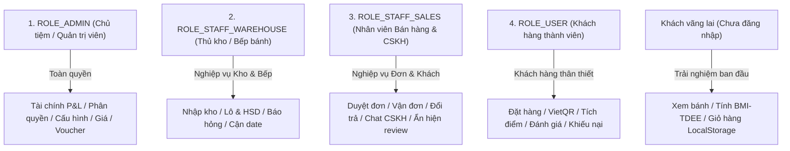
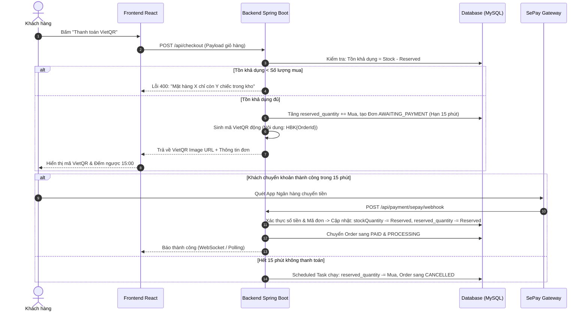
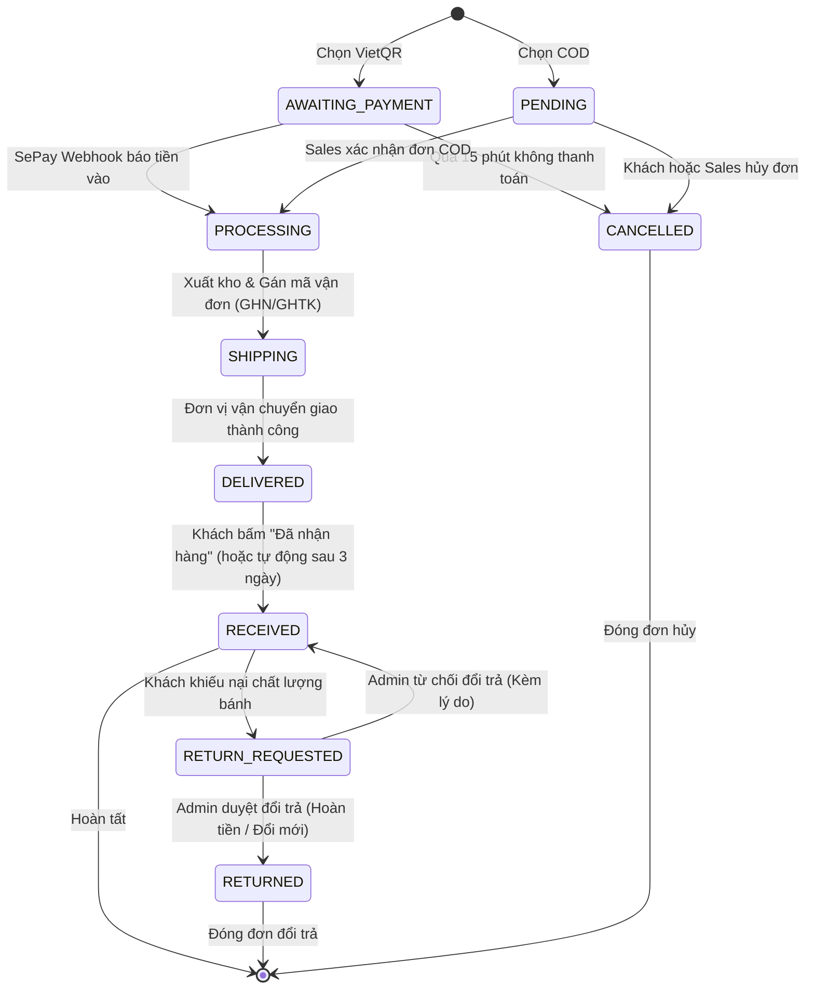

# TÀI LIỆU ĐẶC TẢ NGHIỆP VỤ TOÀN DIỆN DỰ ÁN HEBEKERY
## HỆ THỐNG THƯƠNG MẠI ĐIỆN TỬ & VẬN HÀNH BÁNH HEALTHY (ENTERPRISE EDITION - PHƯƠNG ÁN B)

> **Mã dự án**: Hebekery (WebBakery)  
> **Phiên bản**: 2.0 (Kiến trúc Doanh nghiệp Toàn diện)  
> **Cổng thanh toán**: Tích hợp mã động **VietQR** & Webhook đối soát tự động qua **SePay** (thay thế hoàn toàn MoMo cũ)  
> **Lưu trữ truyền thông**: Cloudinary CDN  
> **Công nghệ giao diện**: React 18+, TypeScript, Tailwind CSS, shadcn/ui, animate-ui (Motion), TanStack Query  
> **Công nghệ lõi Backend**: Spring Boot 3.x, Spring Security, JWT Stateless, Liquibase, MySQL, JUnit 5 & Mockito  

---

## 1. TỔNG QUAN HỆ THỐNG & ĐẶC THÙ NGÀNH F&B HEALTHY

### 1.1. Mô hình kinh doanh
Hebekery là nền tảng thương mại điện tử chuyên biệt cho ngành **Thực phẩm & Bánh Healthy / Ăn kiêng (Eat-Clean, Keto, Low-Carb, Tiểu đường, Thể thao)**, kết hợp hệ thống **Quản trị vận hành kho - bếp - bán hàng (Omnichannel Retail & Mini-ERP)**.

### 1.2. Các bài toán đặc thù của ngành bánh Healthy cần giải quyết
1. **Hạn sử dụng (Shelf-life) ngắn & Kiểm soát Lô (Batch & FEFO)**:
   * Bánh không dùng chất bảo quản, chỉ có hạn từ 5 đến 15 ngày. Bắt buộc phải quản lý theo **Số Lô (`batch_code`)** và ngày hết hạn (`expiry_date`).
   * Xuất kho theo nguyên tắc **FEFO (First Expired, First Out - Hàng hết hạn trước phải xuất trước)**.
   * Tự động cảnh báo bánh cận date (còn $\le 3$ ngày) để kích hoạt cơ chế xả hàng Flash Sale thu hồi vốn.
2. **Biến thể sản phẩm thực tế (Product Variants)**:
   * Khách hàng luôn có nhu cầu chọn Trọng lượng (Hộp 250g, Hộp 500g, Hũ 1kg) và Hương vị (Matcha, Cacao, Vani, Nguyên bản).
   * Mỗi biến thể phải có SKU riêng, giá bán riêng, lượng tồn kho riêng.
3. **Chống bán khống (Overselling / Concurrency Issue)**:
   * Do đặc thù bánh ra lò theo mẻ có số lượng giới hạn, hệ thống bắt buộc phải có cơ chế **Tạm giữ tồn kho (Inventory Reservation)** khi khách bắt đầu thanh toán, tránh trường hợp nhiều người cùng mua vượt quá số lượng mẻ bánh.
4. **Cá nhân hóa dinh dưỡng (Nutrition & Meal Planning)**:
   * Khách hàng ăn kiêng mua bánh dựa trên chỉ số Calo và Macro (Protein, Carbs, Fat, Fiber).
   * Hệ thống tích hợp máy tính chỉ số **BMI & TDEE** và tự động sinh giỏ hàng "Thực đơn tuần đủ Calo" để kích thích mua combo (Upsell).

---

## 2. MA TRẬN PHÂN QUYỀN 4 VAI TRÒ (ENTERPRISE RBAC MATRIX)

Hệ thống phân tách trách nhiệm nghiêm ngặt giữa 4 vai trò:



### Chi tiết quyền hạn theo Role:

| Chức năng nghiệp vụ | Khách (Guest) | Khách quen (`ROLE_USER`) | CSKH (`ROLE_STAFF_SALES`) | Thủ kho (`ROLE_STAFF_WAREHOUSE`) | Chủ tiệm (`ROLE_ADMIN`) |
| :--- | :---: | :---: | :---: | :---: | :---: |
| **Xem catalog, dinh dưỡng, tính BMI/TDEE** | ✅ | ✅ | ✅ | ✅ | ✅ |
| **Đặt hàng & Quét VietQR / SePay** | ✅ | ✅ | ❌ | ❌ | ❌ |
| **Theo dõi tiến trình đơn hàng** | Tra cứu SĐT | Timeline tài khoản | Toàn bộ đơn | Không | Toàn bộ đơn |
| **Xác nhận nhận hàng & Đổi trả** | ❌ | ✅ *(Đơn của mình)* | ❌ | ❌ | ❌ |
| **Tích điểm & Hạng thành viên** | ❌ | ✅ | Xem điểm khách | ❌ | Cấu hình tỷ lệ |
| **Duyệt đơn & Gán mã vận chuyển** | ❌ | ❌ | ✅ | ❌ | ✅ |
| **Xử lý khiếu nại & Duyệt đổi trả** | ❌ | ❌ | ✅ *(Tiếp nhận)* | ❌ | ✅ *(Duyệt hoàn tiền)*|
| **Tạo phiếu nhập kho, quản lý Lô, HSD** | ❌ | ❌ | ❌ | ✅ | ✅ |
| **Báo hỏng / Thanh lý hàng cận date**| ❌ | ❌ | ❌ | ✅ | ✅ |
| **Thêm / Sửa sản phẩm & Giá bán** | ❌ | ❌ | ❌ | ❌ | ✅ |
| **Tạo mã giảm giá (Voucher / Coupon)** | ❌ | ❌ | ❌ | ❌ | ✅ |
| **Xem Báo cáo Doanh thu, Lợi nhuận (P&L)**| ❌ | ❌ | ❌ *(Bị chặn)* | ❌ *(Bị chặn)* | ✅ |
| **Phân quyền & Quản lý User/Staff** | ❌ | ❌ | ❌ | ❌ | ✅ |

---

## 3. PHÂN HỆ SẢN PHẨM, BIẾN THỂ & DINH DƯỠNG (CATALOG & NUTRITION)

### 3.1. Cấu trúc Thực thể Sản phẩm đa biến thể (Product Variant Architecture)
1. **Danh mục (`Category`)**:
   * Phân cấp: Bánh mì tươi nguyên cám, Bánh quy ăn kiêng (Biscotti), Granola & Hạt dinh dưỡng, Bánh trung thu thực dưỡng, Bơ hạt & Mứt không đường.
   * Cột: `id`, `name`, `slug` (URL thân thiện SEO), `description`, `imageUrl`, `displayOrder`, `active`.
2. **Sản phẩm gốc (`Product`)**:
   * Cột: `id`, `category_id`, `name`, `slug`, `description`, `shortDescription`, `basePrice`, `imageUrl`, `nutritionInfo`, `isFeatured`, `active`.
   * **Bảng Nutrition Facts (Giá trị dinh dưỡng trên 100g)**:
     * `calories`: Năng lượng (kcal)
     * `protein_g`: Hàm lượng đạm (g)
     * `carbs_g`: Tinh bột chuyển hóa chậm (g)
     * `fat_g`: Chất béo tốt (g)
     * `fiber_g`: Chất xơ hòa tan (g)
     * `sugar_g`: Đường (cam kết 0g đường tinh luyện hoặc đường ăn kiêng cỏ ngọt)
   * **Bộ lọc chế độ ăn (Dietary Tags)**: `GLUTEN_FREE`, `KETO`, `LOW_CARB`, `VEGAN`, `DIABETIC_FRIENDLY`.
3. **Biến thể sản phẩm (`ProductVariant`)**:
   * Mỗi sản phẩm có 1 hoặc nhiều biến thể kết hợp giữa Trọng lượng và Hương vị.
   * Cột: `id`, `product_id`, `sku` (Mã quản lý kho, ví dụ: `BIS-MATCHA-250G`), `variantName` (Ví dụ: "Hộp 250g - Vị Matcha"), `weightGrams` (250), `flavor` ("Matcha"), `price` (120.000 VNĐ), `originalPrice` (140.000 VNĐ), `stockQuantity`, `lowStockThreshold` (10), `active`.

### 3.2. Quản lý Hình ảnh Đa phương tiện qua Cloudinary
* Không lưu ảnh trên máy chủ backend.
* Upload trực tiếp từ Admin Dashboard qua endpoint `POST /api/upload/image` lên Cloudinary Folder `hebekery/products/`.
* Tự động sinh thumbnail và responsive URL với query: `f_auto,q_auto,w_800,c_limit`.

---

## 4. PHÂN HỆ QUẢN TRỊ KHO, LÔ SẢN XUẤT & HẠN SỬ DỤNG (BATCH & FEFO)

### 4.1. Quản lý Lô sản xuất (`ProductBatch`)
Mỗi lần bếp bánh ra lò hoặc nhập xưởng một mẻ mới, thủ kho tạo 1 bản ghi Lô:
* `id`: Khóa chính
* `batchCode`: Mã lô (ví dụ: `BATCH-20261104-001`)
* `variantId`: Biến thể bánh tương ứng
* `manufacturingDate`: Ngày sản xuất (ngày ra lò)
* `expiryDate`: Ngày hết hạn
* `initialQuantity`: Số lượng ban đầu của mẻ bánh (ví dụ: 100 hộp)
* `currentQuantity`: Số lượng còn lại trong lô
* `unitCost`: Giá vốn sản xuất trên từng đơn vị của lô này
* `status`: `ACTIVE` (Đang bán), `NEAR_EXPIRATION` (Cận hạn), `EXPIRED` (Hết hạn), `SOLD_OUT` (Đã hết hàng)

### 4.2. Nguyên tắc Xuất kho FEFO (First Expired, First Out)
* Khi khách đặt hàng thành công và đơn hàng được chuyển sang đóng gói:
  * Hệ thống **tự động quét và trừ số lượng của Lô có `expiryDate` gần nhất còn hàng**.
  * Đảm bảo khách hàng luôn nhận được bánh tươi mới nhất trong hạn, và tiệm không bị tồn đọng các mẻ bánh cũ.

### 4.3. Cơ chế Tự động Cảnh báo Cận Hạn & Xả Hàng Flash Sale
* **Cronjob quét tự động** chạy lúc 00:00 hàng ngày:
  * Quét các mẻ bánh có $\text{expiryDate} - \text{Hôm nay} \le 3 \text{ ngày}$.
  * Gửi thông báo đến trang Quản trị Kho.
  * Tự động cập nhật cờ `isNearExpiration = true` trên biến thể để hiển thị nhãn **"Giảm giá 40% - Bánh cận date ăn ngay"** trên trang chủ.

### 4.4. Phiếu Nhập Kho & Tính Giá Vốn Bình Quân Gia Quyền (WAC)
* Khi thủ kho tạo `PurchaseReceipt`:
  $$\text{WAC}_{\text{mới}} = \frac{(\text{Tồn cũ} \times \text{WAC}_{\text{cũ}}) + (\text{Số lượng nhập} \times \text{Giá nhập})}{\text{Tồn cũ} + \text{Số lượng nhập}}$$
* Khi xuất đơn hàng bán, hệ thống lưu vết `costAtSale` vào từng `OrderItem` bằng đúng giá trị WAC tại thời điểm bán để phục vụ báo cáo lợi nhuận chuẩn xác.

---

## 5. CƠ CHẾ KHÓA TỒN KHO & CHỐNG BÁN VƯỢT TỒN (INVENTORY RESERVATION)

Để giải quyết triệt để lỗi Overselling khi chạy các đợt khuyến mãi lớn:



* **Công thức quản lý tồn kho**:
  $$\text{Tồn khả dụng (Available To Sell)} = \text{Tổng tồn vật lý (Physical Stock)} - \text{Đang tạm giữ (Reserved)}$$
* Nếu khách chọn **COD**: Hệ thống trừ tồn vật lý ngay lập tức khi tạo đơn và chuyển trạng thái sang `PENDING` chờ Sales duyệt.
* Nếu khách chọn **VietQR**: Giữ chỗ trong 15 phút. Quá hạn tự động giải phóng tồn kho cho khách khác.

---

## 6. PHÂN HỆ THANH TOÁN TỰ ĐỘNG QUA VIETQR & SEPAY

Thay thế hoàn toàn MoMo cũ bằng phương thức **Chuyển khoản Ngân hàng tự động qua VietQR chuẩn NAPAS 247 và cổng đối soát SePay**.

### 6.1. Ưu điểm thực tế của VietQR + SePay
* **Tiết kiệm chi phí**: Không mất phí chiết khấu cổng thanh toán 2-3% như MoMo/VNPAY. Tiền về trực tiếp tài khoản ngân hàng của tiệm.
* **Tiện lợi cho khách**: 100% người dùng Việt Nam đều có app ngân hàng (MB, VCB, Techcombank, ACB, VPBank...), quét mã QR là thông tin ngân hàng, số tiền, nội dung tự động điền sẵn không thể sai sót.

### 6.2. Cấu trúc Mã VietQR Động
* Khi tạo đơn hàng thanh toán Online, hệ thống sinh URL mã QR theo chuẩn VietQR thông qua SePay:
  ```text
  https://qr.sepay.vn/img?bank={BANK_CODE}&acc={ACCOUNT_NO}&template=compact&amount={TOTAL_AMOUNT}&des=HBK{ORDER_CODE}
  ```
  * `BANK_CODE`: Mã ngân hàng (ví dụ: `MBBank`, `ICB`, `VCB`)
  * `ACCOUNT_NO`: Số tài khoản của chủ tiệm
  * `TOTAL_AMOUNT`: Số tiền chính xác của đơn hàng (sau khi trừ voucher)
  * `des`: Cú pháp nội dung bắt buộc: `HBK` + Mã đơn hàng (ví dụ: `HBK10852`)

### 6.3. Quy trình Xử lý Webhook SePay (Automated IPN)
* **Endpoint tiếp nhận**: `POST /api/payment/sepay/webhook`
* **Xác thực bảo mật**:
  * Kiểm tra Header `Authorization: Apikey <SEPAY_WEBHOOK_API_KEY>` được cấu hình trong biến môi trường.
  * Nếu không khớp key $\rightarrow$ Trả về `401 Unauthorized` ngay lập tức.
* **Xử lý Payload**:
  ```json
  {
    "id": 1827364,
    "gateway": "MBBank",
    "transactionDate": "2026-11-04 22:30:00",
    "accountNumber": "0987654321",
    "code": null,
    "content": "HBK10852 chuyen tien banh",
    "transferType": "in",
    "transferAmount": 280000,
    "accumulated": 15400000,
    "subAccount": null,
    "referenceCode": "FT2630981726"
  }
  ```
* **Logic nghiệp vụ Webhook**:
  1. Trích xuất Regex tìm mã đơn `HBK\d+` từ trường `content`.
  2. Tìm đơn hàng theo mã trong cơ sở dữ liệu.
  3. **Kiểm tra tính toàn vẹn (Anti-Tampering)**:
     * `transferType` phải là `"in"` (tiền vào).
     * `transferAmount` phải $\ge$ `order.total`.
     * Đơn hàng đang ở trạng thái `AWAITING_PAYMENT`.
  4. **Chống trùng lặp (Idempotency)**:
     * Lưu `referenceCode` vào bảng `payment_transactions`. Nếu transaction này đã xử lý rồi thì bỏ qua, trả về HTTP 200.
  5. Cập nhật `order.paymentStatus = 'PAID'`, `order.orderStatus = 'PROCESSING'`.
  6. Chính thức trừ tồn kho và xóa số lượng tạm giữ (`reserved_quantity`).
  7. Bắn thông báo Realtime (WebSocket / SSE) đến màn hình Frontend của khách: *"Thanh toán thành công! Đơn hàng đang được chuẩn bị"*.

---

## 7. PHÂN HỆ VÒNG ĐỜI ĐƠN HÀNG, VẬN CHUYỂN & ĐỔI TRẢ (ORDER & RETURNS)

### 7.1. Máy Trạng thái Đơn hàng (Order State Machine)

Hệ thống quản lý 8 trạng thái chặt chẽ:



### 7.2. Tích hợp Đơn vị Vận chuyển (Logistics Integration)
* Hỗ trợ các đơn vị vận chuyển lớn tại Việt Nam: **Giao Hàng Nhanh (GHN)**, **Giao Hàng Tiết Kiệm (GHTK)**, **Viettel Post**.
* Khi đơn ở trạng thái `PROCESSING`:
  * Nhân viên Sales bấm "Tạo vận đơn": Hệ thống gọi API hãng vận chuyển lấy mã tracking và in nhãn A6 dán lên thùng bánh.
  * Webhook từ hãng vận chuyển tự động đẩy trạng thái: Đang lấy hàng $\rightarrow$ Đang giao (`SHIPPING`) $\rightarrow$ Giao thành công (`DELIVERED`).

### 7.3. Quy trình Đổi trả & Khiếu nại thực tế (Food Return Policy)
* **Quy tắc đặc thù đồ ăn**:
  * Chỉ chấp nhận đổi trả trong vòng **48 giờ** kể từ khi đơn chuyển sang `DELIVERED`.
  * Khách hàng bắt buộc tải lên **Hình ảnh / Video** minh chứng (bánh bị mốc, hộp vỡ nát, sai loại bánh, có dị vật).
* **Quyết định xử lý của Admin**:
  * **Đổi mẻ bánh mới**: Tạo đơn hàng thay thế mới với giá trị 0đ.
  * **Hoàn tiền (Refund)**: Chuyển khoản lại cho khách qua ngân hàng, chuyển trạng thái sang `RETURNED`.
  * **Hủy bỏ hàng hỏng**: Nếu bánh hỏng không thể bán lại, ghi nhận vào `DamagedGoodsReceipt` (tính vào chi phí hao hụt), tuyệt đối không hoàn vào tồn kho bán tiếp.

---

## 8. PHÂN HỆ KHUYẾN MÃI (VOUCHER) & TÍCH ĐIỂM THÀNH VIÊN (LOYALTY)

### 8.1. Động cơ Khuyến Mãi (Voucher / Coupon Engine)
Bảng `vouchers` quản lý các chương trình ưu đãi:
* `code`: Mã nhập (ví dụ: `HEBEHEALTHY`, `FREESHIP50K`)
* `discountType`:
  * `PERCENTAGE`: Giảm theo % (ví dụ: 10%, có `maxDiscountAmount` chặn trần ví dụ tối đa 40.000đ).
  * `FIXED_AMOUNT`: Giảm tiền mặt trực tiếp (ví dụ: 30.000đ).
  * `FREE_SHIPPING`: Miễn phí vận chuyển.
* `minOrderAmount`: Giá trị đơn hàng tối thiểu để được áp dụng (ví dụ: đơn từ 250.000đ).
* `usageLimit`: Tổng số lượt sử dụng toàn hệ thống.
* `usedCount`: Số lượt đã dùng.
* `userLimit`: Số lượt tối đa mỗi khách được dùng (mặc định = 1).
* `startDate` & `endDate`: Thời hạn của chương trình.

### 8.2. Hệ thống Tích điểm & Hạng thành viên (Loyalty Tiers)
* **Quy tắc tích điểm**:
  * Mỗi **10.000 VNĐ** chi tiêu thành công = **1 Điểm thưởng (Hebekery Point)**.
  * 1 Điểm có giá trị quy đổi = **100 VNĐ** khi thanh toán đơn hàng tiếp theo.
* **Cấp bậc thành viên (Membership Tiers)**:
  * **Hạng Đồng (Bronze)**: Mặc định khi tạo tài khoản.
  * **Hạng Bạc (Silver)**: Tích lũy chi tiêu $> 2.000.000$ VNĐ $\rightarrow$ Giảm tự động 5% cho mọi đơn hàng sau.
  * **Hạng Vàng (Gold)**: Tích lũy chi tiêu $> 5.000.000$ VNĐ $\rightarrow$ Giảm tự động 10% + Miễn phí vận chuyển trọn đời.

---

## 9. PHÂN HỆ CÁ NHÂN HÓA THỰC ĐƠN THEO TDEE/CALO (HEALTHY MEAL PLANNER)

Đây là tính năng độc quyền tạo nên bản sắc của Hebekery so với các tiệm bánh ngọt thông thường:

### 9.1. Công cụ phân tích Thể trạng (BMI & TDEE Calculator)
* Khách hàng nhập: Giới tính, Tuổi, Cân nặng (kg), Chiều cao (cm), Tần suất vận động (Ít vận động, Vận động nhẹ, Vận động nhiều).
* Hệ thống tính:
  * **BMR (Basal Metabolic Rate)**: Theo công thức Mifflin-St Jeor.
  * **TDEE (Total Daily Energy Expenditure)**: Lượng calo duy trì cân nặng.
* Khách chọn mục tiêu:
  * **Giảm mỡ**: Calo mục tiêu = $\text{TDEE} - 400$ kcal.
  * **Duy trì sức khỏe / Eat-clean**: Calo mục tiêu = $\text{TDEE}$.
  * **Tăng cơ**: Calo mục tiêu = $\text{TDEE} + 300$ kcal.

### 9.2. Tự động Gợi ý Thực đơn Tuần & 1-Click Upsell
* Dựa trên Calo mục tiêu, thuật toán tự động chọn gói sản phẩm trong 7 ngày:
  * *Bữa sáng*: Bánh mì nguyên cám hạnh nhân (2 lát = 140 kcal).
  * *Bữa phụ 1*: Bánh quy Biscotti yến mạch cam quế (2 miếng = 90 kcal).
  * *Bữa phụ 2*: Sữa chua Hy Lạp kèm 30g Granola siêu hạt (210 kcal).
* **Nút bấm 1-Click Action**: *"Thêm trọn bộ thực đơn tuần vào giỏ"* $\rightarrow$ Đẩy toàn bộ combo vào giỏ hàng với giá ưu đãi giảm 10%.

---

## 10. PHÂN HỆ BÁO CÁO TÀI CHÍNH, GIÁ VỐN & LỢI NHUẬN (FINANCE & P&L)

Dành riêng cho `ROLE_ADMIN` để nắm bắt sức khỏe dòng tiền:

1. **Báo cáo Doanh thu Thuần (Net Revenue)**:
   $$\text{Doanh thu thuần} = \sum \text{Đơn hoàn tất (DELIVERED/RECEIVED)} - \text{Đơn hoàn tiền (RETURNED)}$$
2. **Giá vốn hàng bán (Cost of Goods Sold - COGS)**:
   $$\text{COGS} = \sum (\text{Số lượng bán} \times \text{costAtSale})$$
3. **Chi phí Hỏng hủy / Hết hạn (Damaged & Expired Losses)**:
   $$\text{Chi phí hao hụt} = \sum (\text{Số lượng hủy do hỏng/hết hạn} \times \text{Giá vốn Lô})$$
4. **Lợi nhuận gộp (Gross Profit)**:
   $$\text{Lợi nhuận gộp} = \text{Doanh thu thuần} - \text{COGS} - \text{Chi phí hao hụt} - \text{Chiết khấu Voucher}$$
5. **Xuất báo cáo**:
   * Xuất file CSV chi tiết từng đơn hàng phục vụ phần mềm kế toán (MISA/FAST).
   * Xuất file PDF phiếu tổng kết kết quả kinh doanh tháng (sử dụng thư viện OpenPDF).

---

## 11. BẢNG THIẾT KẾ CƠ SỞ DỮ LIỆU TỔNG THỂ (DATABASE SCHEMA)

Để đáp ứng đầy đủ nghiệp vụ Phương án B, cấu trúc CSDL gồm 18 bảng chuẩn hóa:

```text
1. users                      : Tài khoản (email, password, role, active...)
2. customer_profiles          : Hồ sơ khách (điểm tích lũy loyalty_points, hạng membership_tier, calo mục tiêu)
3. addresses                  : Sổ địa chỉ giao hàng của User
4. categories                 : Danh mục sản phẩm (cha - con, slug SEO)
5. products                   : Sản phẩm gốc (tên, slug, nutrition_facts, is_featured...)
6. product_variants           : Biến thể (sku, trọng lượng, hương vị, giá bán, tồn kho)
7. product_batches            : Lô sản xuất & Hạn sử dụng (batch_code, mfg_date, exp_date, FEFO)
8. purchase_receipts          : Phiếu nhập kho từ nhà cung cấp / bếp bánh
9. inventory_transactions     : Lịch sử biến động kho (nhập, xuất, khóa tồn, hủy hỏng)
10. damaged_goods_receipts    : Phiếu ghi nhận hàng hỏng, hàng hết date tiêu hủy
11. orders                    : Đơn hàng (mã order_code, trạng thái 8 bước, thông tin giao hàng)
12. order_items               : Chi tiết đơn (variant_id, số lượng, đơn giá, cost_at_sale snapshot)
13. order_status_history      : Lịch sử chuyển trạng thái đơn (ai đổi, lúc nào, ghi chú)
14. payment_transactions      : Giao dịch thanh toán SePay (idempotency reference_code, amount, content)
15. vouchers                  : Mã giảm giá, điều kiện tối thiểu, hạn mức dùng
16. voucher_usages            : Lưu vết khách nào đã dùng voucher nào
17. product_reviews           : Đánh giá sao (1-5) & bình luận của khách đã mua
18. contact_messages          : Tin nhắn liên hệ & phản hồi của khách hàng
```

---

## 12. ÁNH XẠ NGHIỆP VỤ VÀO LỘ TRÌNH 4 GIAI ĐOẠN

| Giai đoạn | Trọng tâm công việc nghiệp vụ |
| :--- | :--- |
| **Giai đoạn 1: Backend REST & Security** | * Cấu hình Spring Security với 4 Roles: `ADMIN`, `STAFF_WAREHOUSE`, `STAFF_SALES`, `USER`.<br>* Xây dựng REST API Catalog, DTO chuẩn, Global Exception Handling.<br>* Tích hợp Cloudinary Upload Service.<br>* Phân rã God Controller thành các Controller chuyên trách theo Role. |
| **Giai đoạn 2: Database, Liquibase & Core Logic** | * Triển khai Liquibase 18 bảng theo schema Phương án B.<br>* Xây dựng cơ chế **Tạm giữ tồn kho (Inventory Reservation)** chống Overselling.<br>* Cài đặt thuật toán xuất kho **FEFO** và tính giá vốn **WAC**.<br>* Tích hợp cổng thanh toán **VietQR** & Webhook **SePay** đối soát tự động.<br>* Xây dựng Voucher Engine và Tích điểm thành viên. |
| **Giai đoạn 3: Testing, Swagger & DevOps** | * Viết Unit Test (JUnit 5 + Mockito) cho luồng thanh toán SePay, khóa tồn kho, trừ kho FEFO, tính calo.<br>* Tài liệu hóa OpenAPI / Swagger 3.0 cho tất cả 4 nhóm người dùng.<br>* Đóng gói Docker, Docker Compose (MySQL + Spring Boot + Nginx Reverse Proxy) chuẩn 100% Stateless. |
| **Giai đoạn 4: Frontend React + TypeScript + Motion** | * Xây dựng SPA với React 18, TypeScript, Tailwind CSS, shadcn/ui, animate-ui.<br>* Giao diện Client: Catalog đa biến thể, Công cụ tính BMI/TDEE sinh thực đơn tuần, Giỏ hàng động, Màn hình hiển thị mã VietQR kèm đếm ngược 15 phút và tự động nhận diện thanh toán thành công.<br>* Giao diện Admin/Staff: Dashboard kho quản lý Lô & HSD cận date, Quản lý đơn hàng Kanban, Báo cáo P&L có biểu đồ. |

---

*Tài liệu này là nguồn chân lý nghiệp vụ (Single Source of Truth) chi phối toàn bộ mã nguồn và quy chuẩn kiểm thử của dự án Hebekery.*
